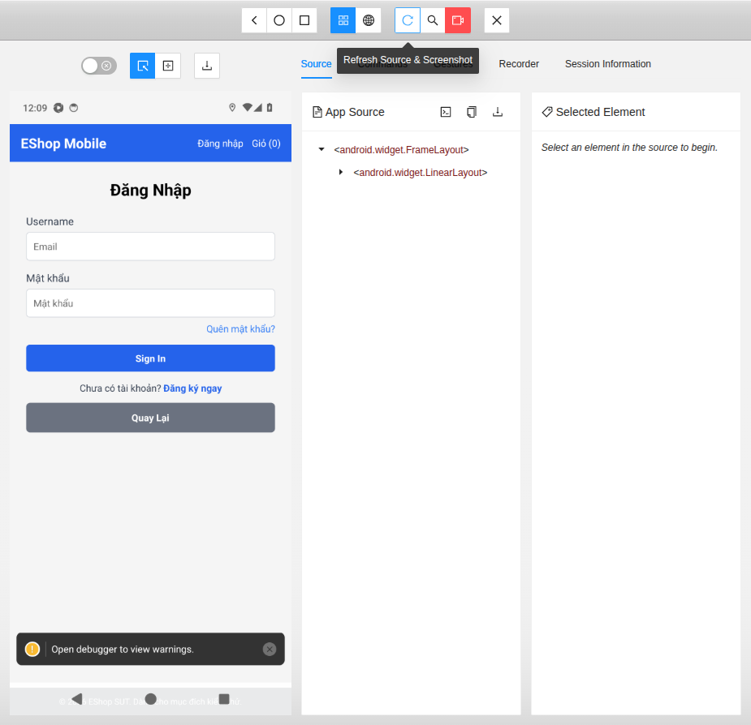
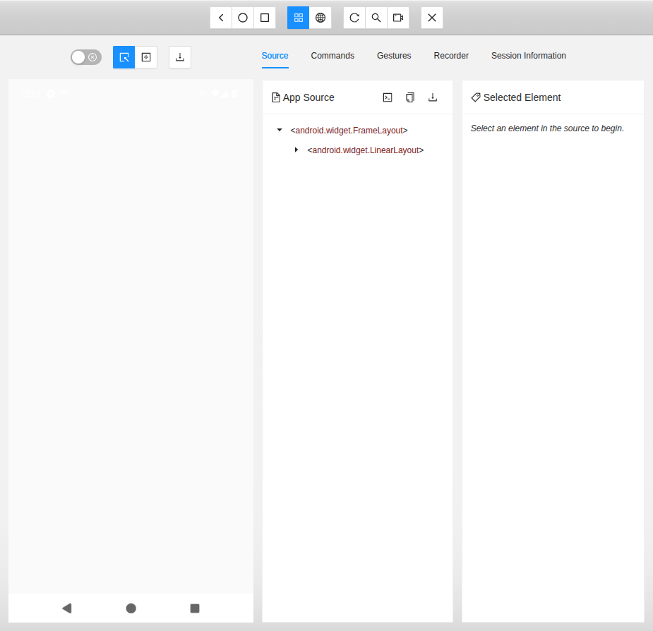
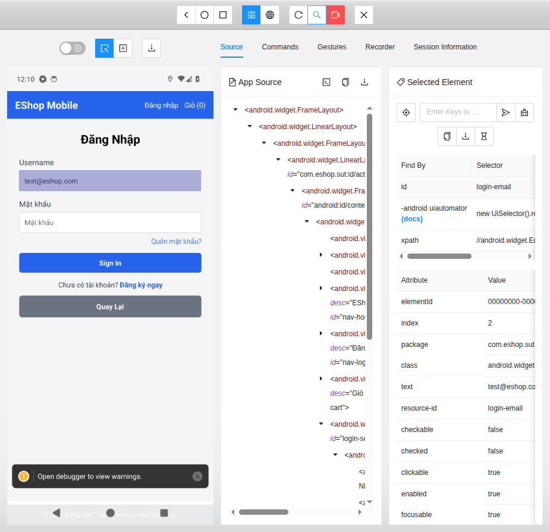
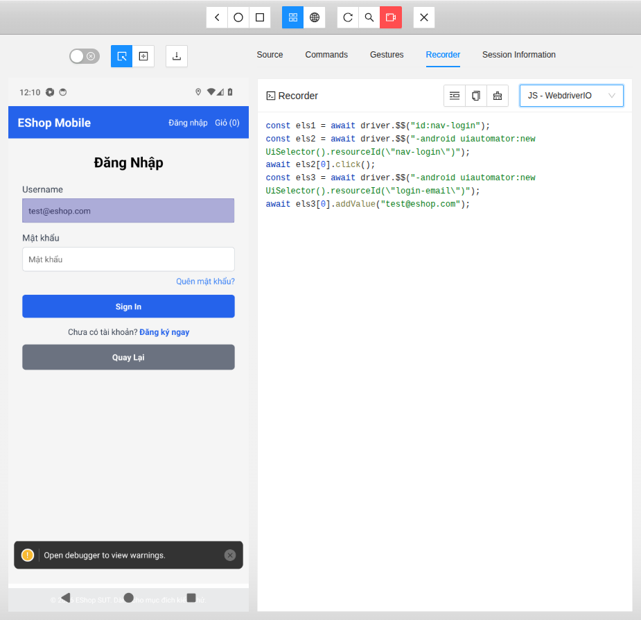
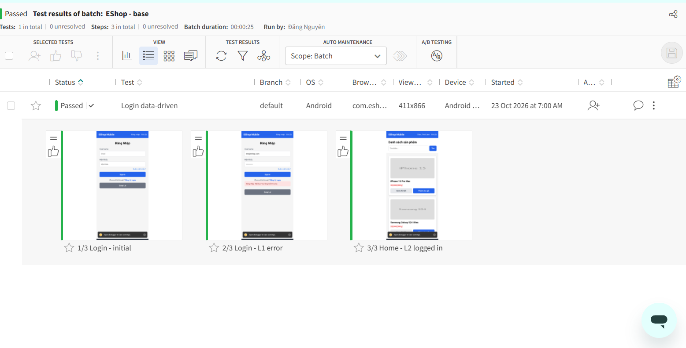

# T03 Mobile Automation Testing — Hướng dẫn sử dụng

**Môn:** CS423 / CSC15003 Kiểm thử phần mềm  
**Đề tài:** T03 — Mobile Automation Testing  
**SUT:** client EShop React Native Expo (`eshop-sut-main/frontend-mobile`)  
**Lớp công cụ:** Appium 2 + UiAutomator2 (chức năng) · Applitools Eyes (giao diện) · Maestro CLI + AI assertions (dự phòng)

**Trạng thái (23/10/2026):** mục 1–7 viết bằng tiếng Việt theo repo hiện tại. Appium: `docs/A1_Setup.md`, `docs/A2_Test_Design.md`, `docs/A3_Metrics.md`, `docs/A4_Detox.md` (AVD `eshop_api34`). Eyes: `src/appium/config/eyes.js`, `docs/B2_Report.md`, ảnh dashboard ở `docs/evidence/B1_B2_applitools-dashboard/` (AVD `Medium_Phone_API_37.0`, cùng độ phân giải 1080×2400). Maestro vẫn chưa có file flow.

**Thông điệp:** Appium kiểm tra việc người dùng làm được và dữ liệu trên màn hình. Applitools kiểm tra thứ người dùng nhìn thấy. Hai lớp bổ sung cho nhau.

---

## Quy ước ký hiệu dùng trong tài liệu

| Ký hiệu | Nghĩa |
|---|---|
| **base / V1 / V2** | Ba bản giao diện EShop dùng cho visual testing, chọn bằng `EXPO_PUBLIC_UI_VARIANT`. base = bản gốc; **V1** = đổi ảnh sản phẩm 1, bố cục giữ nguyên (thay đổi hợp lệ); **V2** = đổi màu giá, màu nút, lệch vị trí nút và dòng tổng tiền (lỗi giao diện) |
| **L1, L2 / S1–S3** | Dòng dữ liệu trong `src/appium/data/cases.js`: đăng nhập (sai mật khẩu, đúng) / tìm kiếm (1, 2, 0 kết quả) |
| **TV1, TV2, TV3** | Ba thành viên nhóm, phụ trách lần lượt Appium–Detox, Applitools–hoạt động lớp, lý thuyết–báo cáo (xem `README.md`) |
| **A1…A4, B1…B6, C1…C6** | Mã công việc nội bộ trong kế hoạch nhóm; tên file và nội dung tương ứng liệt kê ở `README.md` |

## 1. Giới thiệu

### 1.1 Hướng dẫn này để làm gì

Người làm lại bài cần:

1. Khởi động API EShop từ `eshop-sut-main` và xác nhận danh mục mẫu qua HTTP.
2. Cài JDK, Android SDK, emulator, Appium 2 và driver UiAutomator2 khi máy chưa có các công cụ đó.
3. Chạy bộ test trong `src/appium/` trên bản debug Android sau khi thư mục đó có trong cây mã.
4. Đọc checkpoint chức năng đầu: đăng nhập, tìm `iPhone`, thấy tên `iPhone 15 Pro Max`.
5. Đặt `APPLITOOLS_API_KEY`, chạy cùng `npm test` để Eyes chụp checkpoint, rồi so batch `base` / `v1` / `v2` trên dashboard (mục 2.5 và 4.5).
6. Chuyển sang Maestro khi trial Applitools không dùng được và giảng viên đã chấp thuận.

### 1.2 Kiểm thử mobile là gì và vì sao tự động hoá

Kiểm thử ứng dụng mobile là kiểm tra một ứng dụng chạy trên thiết bị di động để xác nhận nó **làm đúng chức năng**, **hiển thị đúng** và **dùng được** trong điều kiện thật của người dùng (nhiều máy, nhiều phiên bản hệ điều hành, mạng không ổn định, bị gián đoạn). Mục đích là tìm lỗi trước người dùng và có bằng chứng để quyết định phát hành. Hướng dẫn này tự động hoá hai khía cạnh: **chức năng** (Appium, assertion trên dữ liệu và trạng thái) và **giao diện** (Applitools Eyes, so với baseline đã duyệt). Tự động hoá hợp với kịch bản lặp lại sau mỗi thay đổi, nhiều bộ dữ liệu và nhiều thiết bị; đổi lại phải bảo trì script khi UI đổi. Lý thuyết đầy đủ (loại app, các khía cạnh kiểm thử, cấp độ, quy trình) ở `Ly_Thuyet_T03_Mobile_Automation.md` mục I.1.a.

Điều kiện môi trường là một phần của bài test: cùng một kịch bản có thể đạt trên ảnh Android này và trượt trên ảnh khác vì phân mảnh OS, quyền, độ trễ mạng và bàn phím ảo. Cấu hình đã chạy đạt là một AVD: `eshop_api34`, Android 14, 1080×2400 (Linux). Ảnh máy thứ hai là một bài test khác.

### 1.3 Mỗi công cụ trả lời câu hỏi nào

| Lớp | Công cụ | Câu hỏi | Trong repo này |
|-----|---------|---------|----------------|
| Chức năng | Appium 2 + UiAutomator2 | Đăng nhập và tìm kiếm có trả dữ liệu đúng không? | `src/appium/`, lệnh `npm test` |
| Visual AI | Applitools Eyes | Màn hình có lệch baseline đã duyệt không? | SDK trong `src/appium`, checkpoint trong test, bằng chứng B2 |
| Dự phòng | Maestro + AI assertions | Cùng luồng có chạy được với một kiểm tra AI nhẹ hơn không? | Chưa có file flow |
| Chính sách | Quy tắc nhóm | Diff nào là lỗi, nhiễu, hay cập nhật có chủ đích? | Mục 4.5–4.6 và `docs/B4_Activity_Worksheet.md` |

Quy tắc demo (Seminar Guide): buổi trình bày có ít nhất một tính năng truyền thống và một tính năng có AI. Tính năng truyền thống là bộ Appium. Tính năng AI là Eyes trên batch `base` / `v1` / `v2`.

### 1.4 Kịch bản trong phạm vi

Bộ test chạy được nằm ở `src/appium/data/cases.js`:

1. Đăng nhập sai mật khẩu, rồi đăng nhập tài khoản mẫu (`L1` → `L2`).
2. Tìm `iPhone` (1 sản phẩm), `Pro M` (2 sản phẩm), `Nokia 3310` (0 sản phẩm).
3. Kiểm tra tên, dòng đếm kết quả, và sản phẩm không được xuất hiện.
4. Cùng lệnh `npm test` còn thêm iPhone 15 Pro Max vào giỏ hai lần và kiểm tra tổng tiền. Luồng giỏ nằm sau bài test đầu; mục 3 dừng ở kết quả tìm kiếm.
5. Checkpoint giao diện Eyes, và so sánh bản đổi ảnh sản phẩm (`v1`) với bản đổi màu/bố cục (`v2`), thuộc mục 4.

Bài test đầu không gồm thanh toán, coupon, trang admin, iOS và device farm.

Bài một người khác làm lại hẹp hơn cả bộ: đăng nhập tài khoản mẫu, tìm `iPhone`, thấy `iPhone 15 Pro Max`. Lệnh có sẵn vẫn là `npm test`, và lệnh đó chạy cả bộ trong một tiến trình.

---

## 2. Cài đặt

`eshop-sut-main` là ứng dụng cần kiểm thử. Thư mục đó không chứa Appium, driver UiAutomator2, Android SDK hay bộ test. Cài các công cụ trên máy, rồi build app. `npm test` cần thêm `src/appium` từ repo seminar.

| Đang có trên đĩa | Mục 2 đưa tới đâu |
|------------------|-------------------|
| Chỉ `eshop-sut-main` | Điều kiện, backend và APK debug. Trước mục 3, chép `src/appium` từ repo seminar vào cùng cây thư mục. |
| Cây seminar: `eshop-sut-main` và `src/appium` | Cùng các công cụ, cài từ project đã khóa trong `src/appium`, rồi sang mục 3. |

`$SUT` là thư mục `eshop-sut-main`. Trong cây seminar, đường dẫn đó là `eshop-sut-main`. Nếu terminal đang đứng trong thư mục SUT thì `$SUT` là thư mục hiện tại. Đặt biến trước các lệnh phía sau.

**Ghi chú hệ điều hành.** A1 đã chạy trên Ubuntu/Linux với Android Emulator. Lệnh `export` và đường dẫn JDK trong mục này là của Linux. Trên Windows PowerShell, đặt cùng các biến bằng `$env:...` theo đường dẫn máy đó. Mã test dùng Node.js và `npm test`, không phụ thuộc Bash. A1 chưa ghi một lượt A1/A2 trên Windows.

Linux hoặc Git Bash:

```bash
export SUT=eshop-sut-main
# đang đứng trong thư mục SUT: export SUT=.
```

Windows PowerShell:

```powershell
$SUT = "eshop-sut-main"
# đang đứng trong thư mục SUT: $SUT = "."
```

### 2.1 Điều kiện

Bảng dưới là những thứ máy phải có. Bài test đầu cần mọi dòng trừ Eyes và Maestro. Máy đã có đủ thì chạy cột **Kiểm tra** rồi sang mục 2.2. Máy Ubuntu chưa có gì thì làm theo **Cài từ máy trống trên Ubuntu** ngay sau bảng.

| Công cụ | Cài | Kiểm tra |
|---------|-----|----------|
| Node.js | 20.19 trở lên. Bản 22.13 trở lên chỉ dành cho PoC Detox ở mục 4.7. | `node -v` và `npm -v` |
| JDK | 17 hoặc 21. Bản build Android đã ghi dùng 21. Trỏ `JAVA_HOME` vào bản đó. | `java -version` in đúng JDK vừa đặt |
| Android SDK | Đặt `ANDROID_HOME`. Có platform-tools (`adb`), emulator, cmdline-tools (`sdkmanager`, `apkanalyzer`), **SDK Platform 36** và **Build-Tools 36.0.0**. Expo SDK 54 biên dịch app với Platform 36. | `adb version`. `sdkmanager --list_installed` liệt kê `platforms;android-36` và `build-tools;36.0.0`. |
| AVD | Tạo `eshop_api34`, Android 14 (API 34), 1080×2400. Đó là thiết bị của bộ test đã ghi. | `emulator -list-avds` in `eshop_api34`. Sau khi boot, `adb devices` hiện `device`. |
| Appium 2 + UiAutomator2 | Không nằm trong SUT. Mục 2.4 cài từ `src/appium`. | `GET http://127.0.0.1:4723/status` trả `ready: true`. |
| Eyes, Maestro | Để ngoài bài test đầu. | — |

#### Cài từ máy trống trên Ubuntu

Đây là cách máy TV1 (Ubuntu 24.04, x86_64) đã được cài. Máy này không dùng Android Studio; Android SDK được cài bằng command-line tools. Cần quyền `sudo`, có mạng và khoảng **20 GB trống**: SDK khoảng 5 GB, máy ảo 3 GB, cache Gradle gần 4 GB, gói npm vài GB. Làm đúng thứ tự, vì bước sau dùng kết quả của bước trước. Mỗi bước có lệnh **Kiểm tra**.

**Bước 1 · JDK, curl, unzip, git**

```bash
sudo apt update
sudo apt install -y openjdk-21-jdk curl unzip git
```

Kiểm tra: `java -version` in dòng `openjdk version "21…"`. Lần build app đầu tiên (mục 2.3), Gradle có thể tự tải thêm một JDK 17 vào `~/.gradle/jdks` để biên dịch. Việc này tự động, chỉ cần mạng.

**Bước 2 · Node.js 20 qua nvm**

```bash
curl -o- https://raw.githubusercontent.com/nvm-sh/nvm/v0.40.6/install.sh | bash
source ~/.bashrc
nvm install 20
nvm alias default 20
```

Kiểm tra: `node -v` in `v20.19` trở lên. `npm -v` in số phiên bản.

**Bước 3 · Android SDK command-line tools**

```bash
mkdir -p ~/Android/Sdk/cmdline-tools
cd ~/Android/Sdk/cmdline-tools
curl -fLO https://dl.google.com/android/repository/commandlinetools-linux-11076708_latest.zip
unzip -q commandlinetools-linux-11076708_latest.zip
mv cmdline-tools latest
rm commandlinetools-linux-11076708_latest.zip
cd ~
```

Kiểm tra: `~/Android/Sdk/cmdline-tools/latest/bin/sdkmanager --version` in `12.0`.

- Bản 12.0 là bản trên máy TV1. Bản mới hơn có ở https://developer.android.com/studio, mục *Command line tools only*.
- Dòng cảnh báo `This version only understands SDK XML versions up to 3…` không ảnh hưởng.
- Đường dẫn phải đúng là `cmdline-tools/latest/bin/sdkmanager`. Nếu giải nén mà không đổi tên thư mục thành `latest`, `sdkmanager` sẽ báo không xác định được SDK root.

**Bước 4 · Biến môi trường**

Thêm vào cuối `~/.bashrc` để mọi terminal mới đều có. Nếu file đã có các dòng này thì bỏ qua bước này.

```bash
cat >> ~/.bashrc <<'EOF'
export ANDROID_HOME="$HOME/Android/Sdk"
export JAVA_HOME=/usr/lib/jvm/java-21-openjdk-amd64
export PATH="$JAVA_HOME/bin:$ANDROID_HOME/cmdline-tools/latest/bin:$ANDROID_HOME/platform-tools:$ANDROID_HOME/emulator:$PATH"
EOF
source ~/.bashrc
```

Kiểm tra: `echo $ANDROID_HOME` in `/home/<tên-bạn>/Android/Sdk`. `sdkmanager --version` chạy được mà không cần gõ đường dẫn đầy đủ.

**Bước 5 · Gói SDK và ảnh hệ thống Android 14**

```bash
yes | sdkmanager --licenses
sdkmanager --install "platform-tools" "emulator" "platforms;android-36" "build-tools;36.0.0" "system-images;android-34;default;x86_64"
```

Lệnh thứ nhất chấp nhận các giấy phép của Google. Lệnh thứ hai tải vài GB, mất 5–15 phút tuỳ mạng.

Kiểm tra: `adb version` chạy được. `sdkmanager --list_installed` liệt kê đủ 5 gói trên.

NDK và CMake không cần cài tay. Gradle tự tải hai gói này khi build app lần đầu (mục 2.3).

**Bước 6 · Tăng tốc ảo hoá (KVM)**

```bash
emulator -accel-check
```

Kiểm tra: dòng cuối có `KVM (version …) is installed and usable.` Nếu báo không dùng được:

```bash
sudo apt install -y qemu-kvm
sudo usermod -aG kvm $USER
```

Sau đó đăng xuất rồi đăng nhập lại. Nếu vẫn lỗi, bật ảo hoá (Intel VT-x hoặc AMD-V/SVM) trong BIOS. Không có KVM thì emulator không khởi động được, hoặc chạy rất chậm.

**Bước 7 · Tạo máy ảo `eshop_api34`**

```bash
echo no | avdmanager create avd -n eshop_api34 -k "system-images;android-34;default;x86_64" -d pixel_6
```

- `echo no` trả lời câu hỏi "có tạo hồ sơ phần cứng riêng không".
- Hồ sơ `pixel_6` cho màn hình 1080×2400, 420 dpi, đúng thiết bị của các lượt đã ghi.

Kiểm tra: `emulator -list-avds` in `eshop_api34`.

**Bước 8 · Mở máy ảo**

```bash
emulator -avd eshop_api34 -no-audio -no-boot-anim
```

Lệnh này chạy mãi, nên mở terminal khác cho các bước sau. Lần boot đầu mất 1–3 phút. Kiểm tra:

```bash
adb devices                            # có dòng: emulator-5554   device
adb shell getprop sys.boot_completed   # in: 1
```

- **Cửa sổ emulator đen** trong khi `sys.boot_completed` đã là `1`: máy ảo đang tắt màn hình.
  - Bấm nút nguồn ⏻ ở thanh bên phải emulator, hoặc chạy `adb shell input keyevent KEYCODE_WAKEUP && adb shell wm dismiss-keyguard`.
  - Để màn hình luôn sáng: `adb shell svc power stayon true`.
- **Hộp thoại "System UI isn't responding":** bấm **Wait** (mục 5.6a).
- **Trước khi chạy Eyes:** tắt animation bằng các lệnh ở mục 2.7.

Xong bước 8, máy đã đủ các dòng trong bảng trừ Appium. Appium cài ở mục 2.4, sau khi có backend và app.

**Dùng Android Studio thay cho bước 3, 5 và 7.**
- SDK Manager → *SDK Platforms*: tích **Android 16 (API 36)**.
- SDK Manager → *SDK Tools*: bật *Show Package Details*, rồi tích **Build-Tools 36.0.0**, **Android SDK Command-line Tools (latest)**, **Android Emulator** và **Platform-Tools**.
- Device Manager → *Create Virtual Device* → **Pixel 6** → ảnh hệ thống **API 34, x86_64** → đặt tên `eshop_api34`.

Bước 4, 6 và 8 vẫn làm như trên. Trên máy ARM, chọn ảnh hệ thống ARM cho API 34 và giữ tên `eshop_api34`; ảnh ARM là một thiết bị khác với các lượt đã ghi.

#### Windows

Cài Node.js 20.19+, JDK 17 hoặc 21 và Android Studio. Tạo SDK và AVD như đoạn *Dùng Android Studio* ở trên, rồi đặt biến môi trường. Các bước Windows chưa được nhóm chạy lại từ máy trống.

Windows (PowerShell). Android Studio để SDK trong Local AppData. Trỏ `JAVA_HOME` vào thư mục JDK 17 hoặc 21 của máy:

```powershell
$env:ANDROID_HOME = "$env:LOCALAPPDATA\Android\Sdk"
$env:JAVA_HOME = "C:\Program Files\Java\jdk-21"
$env:Path = "$env:JAVA_HOME\bin;$env:ANDROID_HOME\cmdline-tools\latest\bin;$env:ANDROID_HOME\platform-tools;$env:ANDROID_HOME\emulator;$env:Path"
adb devices
emulator -list-avds
```

Lưu các biến này vào hồ sơ shell để terminal mới vẫn thấy chúng. Trên Windows, đổi `JAVA_HOME` nếu JDK không nằm ở đường dẫn ví dụ.

`appium driver doctor uiautomator2` cần `apkanalyzer` từ cmdline-tools. Cài cmdline-tools nếu doctor báo thiếu. `bundletool`, `ffmpeg` và GStreamer là tuỳ chọn. Server vẫn có thể báo `ready: true` khi thiếu ba mục đó.

### 2.2 Khởi động backend EShop

`server.js` nạp `database.js`, và `database.js` xoá rồi tạo lại bảng mỗi lần khởi động. Mỗi `npm start` là một bộ dữ liệu mẫu mới. Dừng server trước khi chạy `npm run seed:demo`.

Từ gốc seminar, backend là `eshop-sut-main/backend`. Nếu thư mục đang mở đã là SUT thì `cd backend`.

```bash
cd "$SUT/backend"
npm ci
npm start
```

PowerShell, khi `$SUT` đã được đặt:

```powershell
Set-Location "$SUT/backend"
npm ci
npm start
```

Đợi log có đủ ba dòng sau. Thứ tự có thể đảo vì kết nối SQLite và seed chạy song song với lúc server lắng nghe:

```text
Connected to database
Database initialized and seeded (Phase 2).
Server is running on http://localhost:3000
```

Giữ terminal đó. Xác nhận dữ liệu mẫu qua HTTP:

| Yêu cầu | Kỳ vọng |
|---------|---------|
| `GET http://localhost:3000/api/products` | 5 sản phẩm |
| `GET http://localhost:3000/api/products?search=iPhone` | 1 dòng, `iPhone 15 Pro Max` |
| `POST /api/login` với `test@eshop.com` / `Test1234!` | `200`, tên `Test User` |

Một mật khẩu sai cộng 2 vào `login_attempts` (`server.js`). Lần sai thứ hai trong cùng tiến trình khoá tài khoản 3 phút. Khởi động lại `npm start` để seed lại. Chỉ dùng một lần sai khi tới bài đăng nhập ở mục 3.

**Tài khoản mẫu** (`eshop-sut-main/backend/database.js`):

| Vai trò | Email | Mật khẩu |
|---------|-------|----------|
| Người dùng (dùng cho test mobile) | `test@eshop.com` | `Test1234!` |
| Admin | `admin@eshop.com` | `Admin123!` |

**Sản phẩm mẫu:**

| id | Tên | Giá (VND) |
|----|-----|-----------|
| 1 | iPhone 15 Pro Max | 30000000 |
| 2 | Samsung Galaxy S24 Ultra | 28000000 |
| 3 | MacBook Pro M3 | 45000000 |
| 4 | Tai nghe AirPods Pro 2 | 6000000 |
| 5 | Bàn phím cơ Keychron Q1 | 4000000 |

`eshop-sut-main/setup_guide.md` in mật khẩu admin `admin123`. Seed dùng `Admin123!`. Dùng chuỗi trong seed. Bài test đầu dùng tài khoản người dùng, không dùng admin.

Trên emulator, client gọi backend bằng địa chỉ mặc định trong mã. Bài test đầu không cần tạo file env. Giữ backend ở cổng 3000.

### 2.3 Build và cài client mobile

Bước này chỉ cần `$SUT`. Không cần `src/`.

Checkout mới chưa có thư mục `android/` và chưa có APK. Expo sinh chúng. Sau khi build xong, APK debug nằm tại:

`$SUT/frontend-mobile/android/app/build/outputs/apk/debug/app-debug.apk`

Mở AVD và đợi `adb devices` hiện `device`. Sau mỗi lần boot lạnh, chuyển tiếp cổng Metro:

```bash
adb reverse tcp:8081 tcp:8081
cd "$SUT/frontend-mobile"
npm ci
npx expo run:android
```

PowerShell:

```powershell
adb reverse tcp:8081 tcp:8081
Set-Location "$SUT/frontend-mobile"
npm ci
npx expo run:android
```

**Lần build đầu mất 10–20 phút.**
- Gradle tải thư viện Android, NDK 27.1, CMake 3.22.1 và có thể cả một JDK 17. Tổng khoảng 4–5 GB, cần mạng.
- Bước biên dịch mã C++ của React Native rất nặng CPU và RAM, nên đóng bớt ứng dụng khác.
- `npx expo run:android` chỉ biên dịch cho kiến trúc CPU của máy ảo đang mở (APK của nhóm chỉ chứa `x86_64`). Không ép build đủ bốn kiến trúc: trên máy 8 nhân, 15 GB RAM, không có swap của nhóm, một lượt build như vậy chạy cùng emulator và VS Code đã làm cả hai ứng dụng bị tắt đột ngột.
- Xong, lệnh tự cài app lên máy ảo, mở app và để Metro chạy trong terminal đó.

Giữ Metro chạy. Thay đổi chỉ có JavaScript có thể nạp lại qua Metro. Thay đổi native cần `npx expo run:android` lần nữa.

**Những lần sau**, khi APK debug đã cài trên máy ảo, không cần build lại. Bản debug tải giao diện (JavaScript) từ Metro, nên chỉ cần bật Metro:

```bash
cd "$SUT/frontend-mobile"
npx expo start --localhost --port 8081
```

`--localhost` để Metro nhận kết nối qua `adb reverse` ở trên. Đừng mở app bằng Expo Go: Appium mở APK debug đã cài (đường dẫn ở `src/appium/config/session.js`).

### 2.4 Cài Appium 2 và driver UiAutomator2

Appium 2 chỉ gồm server. Driver Android cài riêng. WebdriverIO là client của bộ test. Cài cả hai bằng script trong `src/appium`.

Linux, khi cây seminar đã có `src/appium`:

```bash
cd src/appium
npm ci
export APPIUM_HOME="$PWD/.appium"
npm run driver:install
npm run driver:doctor
npm run server
```

Windows PowerShell:

```powershell
Set-Location src/appium
npm ci
$env:APPIUM_HOME = Join-Path (Get-Location) ".appium"
npm run driver:install
npm run driver:doctor
npm run server
```

`npm run server` lắng nghe `127.0.0.1:4723`. Đặt `APPIUM_HOME` bằng `src/appium/.appium` ở mọi terminal sau này. Thư mục đó bị git bỏ qua, nên clone mới phải cài driver lại.

Nếu đĩa chỉ có `eshop-sut-main`, chép `src/appium` từ repo seminar để cây thành:

```text
<seminar-root>/
  eshop-sut-main/
  src/appium/
```

Rồi dùng các lệnh ở trên. `eshop-sut-main` không có `npm test` của Appium. Nếu `src/appium` không nằm tại `<seminar-root>/src/appium`, đặt `ESHOP_APK_PATH` thành đường dẫn tuyệt đối của `app-debug.apk`. Mặc định trong `config/session.js` giả định đúng bố cục seminar.

**Xác nhận server**

- Log có dòng `Appium REST http interface listener started on http://127.0.0.1:4723`.
- `GET http://127.0.0.1:4723/status` trả `"ready": true` và `"message": "The server is ready to accept new connections"`.
- Sẵn sàng đọc ở `/status`. Đường `/` không phải trang trạng thái.

`driver doctor` phải thấy `ANDROID_HOME`, `adb`, `emulator` và `JAVA_HOME`. Nếu thiếu `apkanalyzer`, cài cmdline-tools (mục 2.1) rồi chạy doctor lại. Khi `adb` đã có trên `PATH`, dòng doctor bảo cài lại cả SDK nghĩa là thiếu gói cmdline-tools. Cảnh báo `bundletool`, `ffmpeg` và GStreamer không chặn bài test đầu.

Capability mà bộ test gửi nằm trong `src/appium/config/session.js`: `platformName` là `Android`, automation là `UiAutomator2`, app là APK debug ở mục 2.3 hoặc `ESHOP_APK_PATH`, `noReset` là `false`. Client nối `127.0.0.1:4723`, đường `/`.

Inspector dùng khi cần xem cây giao diện. Quit Session trước `npm test`. UiAutomator2 chỉ chạy một instrumentation trên một thiết bị. Ảnh phiên Linux ngày 23/10/2026 nằm ở mục 3.

### 2.5 Applitools Eyes

SDK đã nằm trong `src/appium/package.json` (`@applitools/eyes-webdriverio`). `npm ci` ở mục 2.4 đã kéo SDK. Bộ test gọi `createEyes()` trong mọi file test, nhưng **khoá API là tuỳ chọn**: có khoá thì Eyes chụp checkpoint, không có khoá thì chỉ chạy phần chức năng.

Trong `src/appium`, tạo file `.env` (đã nằm trong `.gitignore`, không commit):

```text
APPLITOOLS_API_KEY=...
```

Hoặc export cùng tên biến trong terminal. **Thiếu khoá thì Eyes tự tắt**: `npm test` vẫn chạy đủ assertion chức năng và in `# Eyes: tắt (không có APPLITOOLS_API_KEY)`. Muốn tắt chủ động dù có khoá: `EYES=off npm test`. Lớp functional vì thế không phụ thuộc vào trial hay khoá của Applitools.

Cấu hình đã khóa trong `src/appium/config/eyes.js` và `config/checkpoints.js`:

| Mục | Giá trị trong repo |
|-----|--------------------|
| App name | `EShop` |
| Tên test (khóa baseline) | `Login data-driven`, `Search data-driven`, `Cart add and total` |
| Match level mặc định | Strict |
| Ignore | thanh trạng thái, vùng `1080×80` ở đỉnh (đổi theo độ phân giải AVD) |
| Layout | ảnh sản phẩm id 1 (`product-image-1`) trên Home và Search |
| Batch | `EShop - ${VARIANT_LABEL}`; mặc định `VARIANT_LABEL=base` |

`eyes.close(false)` không làm terminal đỏ khi có diff visual, nhưng mỗi test in một dòng `# Eyes: <trạng thái> | ... | <link>` vào TAP. Chi tiết Passed / Unresolved xem trên [dashboard Applitools](https://eyes.applitools.com). Ảnh batch `EShop - base` đã Passed nằm ở `docs/evidence/B1_B2_applitools-dashboard/login_base.png`.

Baseline gắn với viewport và thiết bị đã duyệt. Lần B2 dùng AVD `Medium_Phone_API_37.0`, 1080×2400, viewport dashboard khoảng 411×866. Đổi AVD hoặc độ phân giải sẽ tạo baseline mới, không so được với batch đã Accept.

### 2.6 Maestro (chỉ phương án dự phòng)

Bỏ qua, trừ khi giảng viên chấp nhận Maestro thay trial Applitools đã hết. Checkout SUT không có file flow Maestro.

### 2.7 Mỗi lần làm việc: bật lại môi trường

Mục 2.1–2.5 làm một lần. Những lần sau (tắt máy, mở lại), chỉ cần bật lại môi trường theo thứ tự dưới. Máy ảo, backend, Metro và Appium mỗi thứ chạy trong một terminal riêng. Mọi terminal phải có `ANDROID_HOME`, `JAVA_HOME` và `PATH` của mục 2.1; lưu chúng vào hồ sơ shell (`~/.bashrc`, hoặc biến môi trường người dùng trên Windows) để khỏi đặt lại.

| # | Thành phần | Làm gì | Lệnh (từ gốc seminar) | Kiểm tra |
|---|------------|--------|------------------------|----------|
| 1 | Máy ảo | Điện thoại Android chạy app EShop | `emulator -avd eshop_api34` | `adb devices` hiện `device` |
| 2 | Cổng Metro | Cho app trong máy ảo gọi Metro trên máy tính | `adb reverse tcp:8081 tcp:8081` (chạy lại sau mỗi lần máy ảo khởi động) | Lệnh in `8081` |
| 3 | Backend | API sản phẩm, đăng nhập, giỏ; mỗi lần `npm start` tạo lại dữ liệu mẫu | `cd eshop-sut-main/backend` rồi `npm start` | `http://localhost:3000/api/products` trả 5 sản phẩm |
| 4 | Metro | Cung cấp giao diện cho APK debug | `cd eshop-sut-main/frontend-mobile` rồi `npx expo start --localhost --port 8081` | `http://localhost:8081/status` trả `packager-status:running` |
| 5 | Appium server | Nhận lệnh từ test hoặc Inspector | `cd src/appium`, đặt `APPIUM_HOME` (mục 2.4), rồi `npm run server` | `http://127.0.0.1:4723/status` có `"ready":true` |

Sau đó, ở một terminal khác trong `src/appium` (cùng `APPIUM_HOME`): `npm test`. Không cần `npx expo run:android` nữa, trừ khi đổi mã native hoặc máy ảo đã bị xoá app.

Muốn dùng cả Inspector (mục 4.3) lẫn `npm test` trên cùng một server, thay bước 5 bằng lệnh có plugin Inspector:

```bash
npx appium --address 127.0.0.1 --port 4723 --use-plugins=inspector --allow-cors --allow-insecure=uiautomator2:adb_shell
```

Gõ lệnh `npx appium` khi đang đứng trong `src/appium`; ở thư mục khác, npx sẽ đòi tải Appium 3 (mục 5.9).

Nếu chạy Eyes, tắt animation của máy ảo một lần sau khi khởi động để ảnh chụp ổn định (`run-variants.sh` tự làm bước này):

```bash
adb shell settings put global window_animation_scale 0
adb shell settings put global transition_animation_scale 0
adb shell settings put global animator_duration_scale 0
```

---

## 3. Bài test đầu

Mục tiêu: một đường chức năng. Visual AI đi sâu ở mục 4, nhưng `npm test` sẽ mở Eyes và chụp checkpoint khi có khoá (không có khoá thì Eyes tắt, chỉ còn functional), nên muốn có checkpoint Eyes thì đặt `APPLITOOLS_API_KEY` ở bước 6 (mục 2.5). Không có khoá, bộ test vẫn chạy đủ phần chức năng. Làm xong mục 2 trước. Nếu đĩa chỉ có `eshop-sut-main`, chép `src/appium` rồi làm mục 2.4 trước bước 6. Kết quả chức năng cả bộ đã ghi nằm ở `docs/A3_Metrics.md`: 3 test, 8 kiểm tra, 10/10 lượt trên AVD `eshop_api34`.

Một lượt đạt của đường đầu trông như sau:

- Mật khẩu sai `SaiMatKhau-1` còn ở màn Đăng nhập. Dòng lỗi khớp `Đăng nhập thất bại`. App luôn hiện `Đăng nhập thất bại. Vui lòng kiểm tra lại.`
- Mật khẩu mẫu `Test1234!` hiện lời chào `Chào, Test User`.
- Tìm `iPhone` hiện `Hiển thị 1 sản phẩm` và tên `iPhone 15 Pro Max`.

Màn Đăng nhập trên emulator, chụp trong Appium Inspector ngày 23/10/2026. Ô email đã có `test@eshop.com`. Cây nguồn bên phải lúc chụp chưa được làm mới.



Phiên Inspector vừa mở có thể vẫn hiện màn hình Android trống cho tới khi app được đưa lên trước. Ảnh dưới là trạng thái đó, cùng ngày, trước khi màn Đăng nhập xuất hiện trong khung điện thoại.



### 3.1 Mười bốn bước

1. Trong `$SUT/backend`, chạy `npm start`. Đợi `Database initialized and seeded` và `Server is running on http://localhost:3000`.
2. Mở `http://localhost:3000/api/products`. Kỳ vọng 5 sản phẩm. Mở `http://localhost:3000/api/products?search=iPhone`. Kỳ vọng một dòng, `iPhone 15 Pro Max`.
3. Khởi động AVD `eshop_api34` và đợi `adb devices -l` báo trạng thái `device`.
4. Chạy `adb reverse tcp:8081 tcp:8081`.
5. Nếu app debug chưa được cài, chạy `npm ci` rồi `npx expo run:android` từ `$SUT/frontend-mobile`. Giữ Metro. Nếu app đã cài từ lần trước, chỉ bật Metro: `npx expo start --localhost --port 8081` (mục 2.3, 2.7).
6. Trong `src/appium`, đặt `APPIUM_HOME` tới thư mục `.appium` của thư mục đó (mục 2.4). Đặt `ANDROID_HOME` và `JAVA_HOME` như mục 2.1. Muốn bật Eyes thì đặt `APPLITOOLS_API_KEY` (file `.env` hoặc export, mục 2.5); không có khoá thì Eyes tự tắt. Nếu APK không nằm ở đường mặc định của seminar, đặt `ESHOP_APK_PATH` thành đường tuyệt đối của file APK.
7. Bật server bằng `npm run server`.
8. Mở `http://127.0.0.1:4723/status`. Chỉ tiếp tục khi `ready` là `true`.
9. Quit mọi phiên Inspector. Một instrumentation UiAutomator2 cho một thiết bị. `npm test` thất bại nếu Inspector còn giữ phiên.
10. Từ terminal thứ hai trong `src/appium`, cùng `APPIUM_HOME` (và `APPLITOOLS_API_KEY` nếu muốn bật Eyes), chạy `npm test`. Đó là `node --test --test-concurrency=1`. Assertion chức năng in ra terminal; kết quả Eyes xem trên dashboard.
11. Ở test đăng nhập, `L1` còn màn Đăng nhập, có dòng `Đăng nhập thất bại`, và chưa có lời chào `Test User`. `L2` có lời chào `Chào, Test User` và không còn dòng lỗi.
12. Ở test tìm kiếm, từ khoá `iPhone` tới `Hiển thị 1 sản phẩm` và tên `iPhone 15 Pro Max`. Các sản phẩm còn lại không còn trên màn hình. Đây là checkpoint của bài test đầu.
13. Không nhập mật khẩu sai lần thứ hai khi tiến trình backend này còn chạy. Mỗi lần sai cộng 2 vào `login_attempts`, và tài khoản khoá 3 phút khi đạt 3. Nếu một lượt chết sau `L1` và trước `L2`, dừng backend rồi khởi động lại để seed sạch, sau đó chạy lại `npm test`.
14. Cùng `npm test` còn chạy tiếp `Pro M` (2 tên), `Nokia 3310` (dòng đếm kết quả biến mất) và tổng giỏ `60000000`. TAP xanh của cả bộ là `# pass 8` và `# fail 0`. Đó là bộ seminar. Bài test đầu xong ở bước 12.

Bộ test đã chờ màn Đăng nhập, lời chào và kết quả tìm kiếm, và ẩn bàn phím sau đăng nhập (`src/appium/tests/helpers.js`). Không thêm `sleep` cố định.

### 3.2 Chỗ các bước nằm trong mã

| Phần | File |
|------|------|
| Capability của phiên | `src/appium/config/session.js` |
| Thao tác đăng nhập và tìm kiếm | `src/appium/pages/login.page.js`, `src/appium/pages/home.page.js` |
| Dòng `L1`, `L2`, `S1`–`S3` | `src/appium/data/cases.js` |
| Test mà `npm test` chạy | `src/appium/tests/login-search.test.js` (và `cart-total.test.js` cho bước 14) |

Đoạn Recorder của Inspector là bản nháp. Test nộp là Page Object ở bảng trên. Bản ghi ngày 23/10/2026 nằm trong `docs/evidence/` của repo seminar.

### 3.3 Một file mẫu đủ cấu trúc

Bộ test thật chia ra nhiều file (bảng 3.2). Muốn xem cả cấu trúc của một test Appium trong một chỗ, đọc `src/appium/examples/search-example.js`. File tự chứa, không import từ bộ test, và đánh số bảy phần theo đúng thứ tự một test chạy:

| Phần | Nội dung | Tương ứng trong bộ test thật |
|------|----------|------------------------------|
| 1. Session & Capabilities | Mở phiên với máy ảo | `config/session.js` |
| 2. Locator | Tìm phần tử theo `resource-id` | `config/locators.js` |
| 3. Page Object | Lớp `HomeScreen` gom locator và thao tác của màn chính | `pages/home.page.js` |
| 4. Data | Bảng hai từ khoá và kết quả mong đợi | `data/cases.js` |
| 5. Eyes (tuỳ chọn) | Chỉ bật khi có `APPLITOOLS_API_KEY` | `config/eyes.js`, `config/checkpoints.js` |
| 6. Test | Action → wait → assertion, lặp theo bảng | `tests/login-search.test.js` |
| 7. Teardown | Đóng phiên trong `finally`, kể cả khi test fail | Mọi file trong `tests/` |

Chạy sau bước 1–9 của mục 3.1, từ `src/appium`:

```bash
npm run example
```

File mẫu chỉ tìm kiếm, không đăng nhập, nên không cộng vào bộ đếm sai mật khẩu của backend. Lượt chạy ngày 27/10/2026 trên AVD `eshop_api34`: `# pass 3`, `# fail 0` (1 test, 2 dòng dữ liệu), khoảng 30 giây. Có khoá Applitools thì in thêm dòng `Eyes: Passed`, batch `EShop - example`, khoảng 47 giây. `npm test` không chạy file này, nên bộ seminar vẫn là `# pass 8`.

Muốn thấy data-driven hoạt động, thêm một dòng vào bảng `SEARCH_CASES` rồi chạy lại, ví dụ `{ keyword: "Samsung", count: 1, names: { 2: "Samsung Galaxy S24 Ultra" } }`. Lượt thử ngày 27/10/2026 cho `# pass 4` mà không sửa dòng code test nào.

---

## 4. Dùng nâng cao

Mục 2–3 là mức cài đặt và bài test đầu (đăng nhập rồi tìm `iPhone`). Mục này là phần còn lại của buổi demo: Inspector và Recorder, cả bộ dữ liệu, tổng giỏ, và khung Eyes. Detox là đối sánh DX, không phải công cụ demo thứ ba.

Workflow Briefing giữ video 5–8 phút. Lệnh và giải thích dài nằm ở đây. Một mức chỉ được gọi là đã trình bày khi mức đó có trong video hoặc trong bằng chứng của nhóm. Đề cương thời gian nằm ở `Demo_Scenario.md`. Video demo (6:51, thuyết minh tiếng Anh): link trong `Demo_Video_Links.md`.

### 4.1 Ba mức demo

| Mức | Appium | Eyes |
|-----|--------|------|
| Cài đặt | Mục 2. `GET http://127.0.0.1:4723/status` có `ready: true`. Phạm vi đã chạy là Linux, AVD `eshop_api34` (A1). | Mục 2.5: SDK qua `npm ci`, `APPLITOOLS_API_KEY`, app name `EShop`. |
| Chức năng cơ bản | Inspector trên màn Đăng nhập, chọn ô email, bật Recorder (mục 4.3). | Một batch `EShop - base` so với baseline đã Accept (mục 4.5). Ảnh: `docs/evidence/B1_B2_applitools-dashboard/login_base.png`. |
| Luồng phức tạp | `npm test`: bảng đăng nhập, bảng tìm kiếm, giỏ hai lần và tổng tiền (mục 4.4). | Cùng luồng trên `v1` (đổi ảnh sản phẩm) và `v2` (đổi màu/bố cục). Báo cáo: `docs/B2_Report.md`. |

Phần live 10 phút không mở Inspector. Nếu cần nhắc Recorder, chiếu đoạn video của mức cơ bản. Backend, Metro, emulator và Appium được bật trước.

### 4.2 Ba khối Record, data-driven, checkpoint

| Khối | Trong repo | Vai trò ở buổi demo |
|------|------------|---------------------|
| Record & Playback | Plugin Inspector trong trình duyệt. Ảnh và file Recorder ngày 23/10/2026 ở `docs/evidence/`. | Khám phá cây giao diện. Code sinh ra là bản nháp. |
| Data-driven | `src/appium/data/cases.js`: `LOGIN_CASES`, `SEARCH_CASES`, `CART_CASE`. Thêm dòng không sửa assertion. | Demo phức tạp đọc bảng, không đọc số viết cứng trong test. |
| Checkpoint | Assertion chức năng trong `tests/*.test.js`, cộng visual checkpoint qua `config/checkpoints.js` (Login, Home, Search, Cart). | TAP xanh cho dữ liệu; dashboard Eyes cho giao diện. |

Maestro không có file flow, nên không thay khối nào ở trên.

### 4.3 Record và Playback — demo cơ bản

Làm sau mục 2, khi emulator đang `device`, Metro đang chạy và APK debug đã cài. Cài plugin một lần trong `src/appium`, cùng `APPIUM_HOME` với server. Bản plugin đã dùng là `appium-inspector-plugin@2025.3.1`. Bản mới hơn đòi Appium 3.

Linux:

```bash
cd src/appium
export APPIUM_HOME="$PWD/.appium"
npx appium plugin install --source=npm appium-inspector-plugin@2025.3.1
npx appium --address 127.0.0.1 --port 4723 --use-plugins=inspector --allow-cors --allow-insecure=uiautomator2:adb_shell
```

Windows PowerShell:

```powershell
Set-Location src/appium
$env:APPIUM_HOME = Join-Path (Get-Location) ".appium"
npx appium plugin install --source=npm appium-inspector-plugin@2025.3.1
npx appium --address 127.0.0.1 --port 4723 --use-plugins=inspector --allow-cors --allow-insecure=uiautomator2:adb_shell
```

Cờ `--allow-insecure=uiautomator2:adb_shell` giống `npm run server`, để cùng một server dùng được cho cả Inspector lẫn `npm test` có Eyes. Nếu cổng 4723 đang có server khác chạy, tắt server đó trước (mục 5.9).

Mở `http://127.0.0.1:4723/inspector`. Capability lấy từ `src/appium/config/session.js`. Bấm biểu tượng bút ở khung *JSON Representation*, dán đoạn dưới (đổi `appium:app` thành đường dẫn tuyệt đối tới APK debug trên máy bạn), rồi bấm **nút lưu (💾)** ở góc khung. Cột *Capability Builder* bên trái phải hiện đủ 6 dòng; dòng trống nào còn sót thì xoá. Bỏ bước lưu, Inspector báo `Invalid or unsupported WebDriver capabilities found ("undefined")`.

```json
{
  "platformName": "Android",
  "appium:automationName": "UiAutomator2",
  "appium:deviceName": "Android Emulator",
  "appium:app": "<đường dẫn tuyệt đối>/eshop-sut-main/frontend-mobile/android/app/build/outputs/apk/debug/app-debug.apk",
  "appium:appPackage": "com.eshop.sut",
  "appium:noReset": false
}
```

Bấm **Start Session** và đợi khoảng 25 giây để app được cài lại. Nếu ảnh trong Inspector còn trắng và cây giao diện chỉ có vài `FrameLayout` rỗng, app chưa tải xong giao diện: đợi máy ảo hiện danh sách sản phẩm, rồi bấm **Refresh (⟳)** trên thanh công cụ của Inspector.

`testID` trong `eshop-sut-main/frontend-mobile/App.js` hiện trên Android thành `resource-id`. Phiên ngày 23/10/2026 chọn ô email: `resource-id` = `login-email`, chữ trong ô là `test@eshop.com`. Chiến lược Id của Inspector tự thêm tiền tố package nên không khớp các id này. Chiến lược dùng được là UIAutomator: `new UiSelector().resourceId("login-email")`.



Bật Recorder bằng nút **máy quay** (*Start Recording*) trên thanh công cụ, cạnh kính lúp. Chỉ thao tác làm **qua Inspector** mới được ghi (chọn phần tử trên ảnh rồi bấm *Tap* hoặc *Send Keys* ở khung *Selected Element*); bấm trực tiếp trên cửa sổ máy ảo thì không được ghi. Bấm Đăng nhập, gửi email một lần, rồi mở tab **Recorder** và chọn **JS - WebdriverIO** để xem code. File đã lưu là `docs/evidence/A2_inspector_recorder_2026-10-23.js`. Đoạn đó tìm `nav-login` và `login-email` bằng `$$(...)[0]`, không có wait và không có assertion.



Test nộp nằm ở Page Object (`pages/`, `tests/`), không phải file Recorder. Quit Session trước `npm test`. UiAutomator2 chỉ một instrumentation trên một thiết bị; phiên Inspector còn mở thì bộ test đứt.

### 4.4 Bộ dữ liệu và tổng giỏ — demo phức tạp

Đây là phần `npm test` sau checkpoint `iPhone` ở bước 12 của mục 3. Thứ tự đăng nhập cố định: một mật khẩu sai, rồi mật khẩu mẫu. `server.js` cộng 2 vào `login_attempts` mỗi lần sai và khoá 3 phút khi đạt 3. Thêm một dòng sai nữa sẽ khoá `test@eshop.com` đến hết tiến trình backend. Chạy lại `npm start` để seed.

| Id | Đầu vào | Checkpoint |
|----|---------|------------|
| L1 | `SaiMatKhau-1` | Còn màn Đăng nhập; dòng lỗi chứa `Đăng nhập thất bại`; chưa có lời chào |
| L2 | `Test1234!` | Lời chào chứa `Test User`; dòng lỗi biến mất |
| S1 | `iPhone` | `Hiển thị 1 sản phẩm`; tên `iPhone 15 Pro Max`; bốn sản phẩm kia vắng |
| S2 | `Pro M` | `Hiển thị 2 sản phẩm`; có iPhone 15 Pro Max và MacBook Pro M3; Samsung, tai nghe và bàn phím vắng |
| S3 | `Nokia 3310` | Dòng đếm kết quả biến mất; cả năm sản phẩm vắng |

S3 không tìm một câu “không có sản phẩm”. Checkpoint là dòng đếm không còn.

Giỏ (`src/appium/tests/cart-total.test.js`, `CART_CASE`): sản phẩm 1, đơn giá 30000000, bấm **Thêm vào giỏ** hai lần. Huy hiệu thành `Giỏ (1)` vì hai lần bấm cập nhật cùng một dòng. Thành tiền và tổng phải chứa chữ số `60000000`. Bộ test chỉ so chữ số, nên đổi dấu phân cách của `toLocaleString` không làm fail. Xoá dòng thì khung giỏ trống hiện và dòng tổng biến mất.

Hai hành vi của EShop mà test giỏ đã né (A2, mục 5):

- Mỗi lần thêm mở `Alert.alert("Thành công", "Đã thêm vào giỏ hàng")`. `addToCart` bấm `android:id/button1` và đợi nút đó biến mất rồi mới bấm tiếp.
- Ô số lượng trong giỏ làm `parsed + 1` khi đổi (`App.js`). Gõ `2` không ra số lượng 2. Bộ test không gõ ô đó; nó thêm sản phẩm lần nữa.

Bằng chứng cả bộ: chiến dịch 2 của A3, 22–23/10/2026, 10 lượt, mỗi lượt `# pass 8` và `# fail 0`, trung bình 102,284 s, trung vị 102,238 s. Mười lượt này bắt đầu sau khi đã xử lý bàn phím và Alert. Mười lượt không phải xác suất flaky dài hạn. Log ở `docs/evidence/A3_runs_2026-10-22_data-driven.log`.

### 4.5 Eyes — cài đặt, một checkpoint, hai bản UI

Thứ tự trong mã: `eyes.open(driver, "EShop", "<tên test cố định>")` → `checkpoint` / `checkpointAs` sau khi assert xong → `eyes.close(false)`. Tên test cố định là khóa baseline. Batch tên `EShop - base` (hoặc `v1` / `v2`) chỉ nhóm lần chạy trên dashboard, không đổi khóa baseline.

**Mức cơ bản — batch `base` đã duyệt.** Chạy `npm test` với `VARIANT_LABEL=base` (mặc định) và Metro ở bản gốc. Lần đầu trên dashboard: Accept toàn bộ ảnh rồi Save. Lần hai kỳ vọng Passed. Bằng chứng ngày 23/10/2026: test `Login data-driven` Passed, ba bước Login initial / L1 error / Home logged in (`docs/evidence/B1_B2_applitools-dashboard/login_base.png`).



**Hai bản UI có kiểm soát** (`EXPO_PUBLIC_UI_VARIANT` trong Metro; `testID` và chữ không đổi):

| | V1 | V2 |
|--|----|----|
| Thay đổi | Đổi ảnh sản phẩm id 1 (`assets/product-v1.png`), khung giữ nguyên | Giá tím và to hơn; nút lệch; nút thêm giỏ đỏ; tổng tiền lệch trái; nút thanh toán cam |
| Bản chất | Đổi nội dung ảnh có chủ đích | Regression giao diện thật |
| Cách bật | `EXPO_PUBLIC_UI_VARIANT=v1` | `EXPO_PUBLIC_UI_VARIANT=v2` |

**Kết quả đã đo** (`docs/B2_Report.md`, cùng ngày, AVD `Medium_Phone_API_37.0`):

| Lần chạy | Functional | Visual (Eyes) | Kết luận |
|----------|------------|---------------|----------|
| Base lần 2 | Pass 8/8 | Pass 3/3 test | Đối chứng ổn định |
| V1 | Pass 8/8 | Unresolved 3/3 (5/10 checkpoint lệch) | False positive nếu coi đổi ảnh là lỗi; giảm bằng vùng Layout/Ignore đặt trên dashboard (vùng khai báo trong code chưa có hiệu lực, mục 6) |
| V2 | Pass 8/8 | Unresolved 3/3 (6/10 checkpoint lệch) | True regression: Appium bỏ sót, Eyes bắt màu và lệch bố cục |

Ảnh so sánh: `v1_home_with_layout_region.png`, `v1_home_without_layout_region.png`, `v2_home_step.png`, `v2_cart_with_item_step.png` trong `docs/evidence/B1_B2_applitools-dashboard/`.

Chạy cả ba bản từ gốc repo (Git Bash), sau khi mục 2 đã xong:

```bash
export APPLITOOLS_API_KEY="..."
# hoặc ghi vào src/appium/.env
./run-variants.sh            # base (tạo + kiểm baseline) -> v1 -> v2
# hoặc: ./run-variants.sh base|v1|v2
```

Script mở emulator mặc định `eshop_api34`, tắt animation, restart backend mỗi lần, đặt `EXPO_PUBLIC_UI_VARIANT` và `VARIANT_LABEL`. Mỗi lần gọi, script build lại APK ở bản đầu tiên và khởi động lại Appium không kèm plugin Inspector, nên chậm hơn đổi tay. **Không Accept/Save** trên lần chạy `v1` hoặc `v2`; làm vậy sẽ ghi đè baseline.

**Đổi bản giao diện bằng tay** (nhanh hơn, dùng khi demo). Bản giao diện do Metro quyết định; `VARIANT_LABEL` chỉ đặt tên batch trên dashboard, không đổi giao diện. Hai biến phải khớp nhau.

1. Ở terminal Metro, bấm `Ctrl+C`, rồi bật lại với bản muốn chạy. Phải có `--clear`: giá trị biến được ghi vào mã lúc đóng gói, không xoá bộ nhớ đệm thì app vẫn giữ bản cũ.

   ```bash
   cd eshop-sut-main/frontend-mobile
   EXPO_PUBLIC_UI_VARIANT=v2 npx expo start --clear --localhost --port 8081
   ```

   PowerShell: `$env:EXPO_PUBLIC_UI_VARIANT = "v2"; npx expo start --clear --localhost --port 8081`.
2. Mở lại app để nạp bản mới, đợi Metro in `Android Bundled` (khoảng 25 giây sau `--clear`):

   ```bash
   adb shell am force-stop com.eshop.sut
   adb shell monkey -p com.eshop.sut -c android.intent.category.LAUNCHER 1
   ```

   Màn hình V2: giá tím và to hơn, nút "Thêm vào giỏ" đỏ.
3. Từ `src/appium`: `VARIANT_LABEL=v2 npm test`. PowerShell: `$env:VARIANT_LABEL = "v2"; npm test`. Trên PowerShell biến còn giữ cho các lệnh sau, nhớ đặt lại `base`.
4. Về bản gốc: lặp lại bước 1–2 với `base` (hoặc bỏ biến `EXPO_PUBLIC_UI_VARIANT`).

| Thay đổi | Test chức năng | Test giao diện | Cách xử lý sau khi có diff |
|----------|----------------|----------------|----------------------------|
| Ảnh sản phẩm đổi, khung giữ (V1) | Pass | Unresolved nếu so Strict toàn vùng ảnh | Accept nếu chủ ý; hoặc đặt vùng Layout trên ảnh trong dashboard |
| Màu / vị trí nút / tổng tiền lệch (V2) | Pass | Unresolved | Reject, sửa app. Không bỏ qua vùng giá và nút |

### 4.6 Vùng bỏ qua và người được cập nhật baseline

Đã cấu hình trong mã (`config/checkpoints.js`):

| Vùng | Cách so |
|------|---------|
| Thanh trạng thái (`STATUS_BAR` 1080×80) | Ignore |
| Ảnh sản phẩm id 1 trên Home / Search | Layout (bỏ nội dung ảnh, vẫn bắt lệch khung) |
| Giá, tổng tiền, nút đăng nhập / thêm giỏ / thanh toán, form lỗi | Strict — không ignore |

| Có thể bỏ qua hoặc Layout | Không bỏ qua |
|---------------------------|--------------|
| Thanh trạng thái, ảnh sản phẩm khi chỉ đổi nội dung ảnh | Giá và tổng đơn |
| Mốc thời gian ngoài kịch bản | Nút đăng nhập, thêm vào giỏ, thanh toán |
| Vùng marketing đã thống nhất xoay | Dòng lỗi đăng nhập và form đăng nhập |

Người cập nhật baseline phải có chấp thuận của giảng viên hoặc người QA được chỉ định. Chỉ Accept trên batch `base` khi UI gốc đổi có chủ đích. Phiếu ghi lý do, vùng đã bỏ qua, và bản build. Cập nhật baseline để che lỗi V2 làm hỏng oracle. Worksheet phân loại diff: `docs/B4_Activity_Worksheet.md` và `docs/diff-cards/`.

### 4.7 Maestro — chỉ khi được chấp thuận

Repo không có file flow. Dùng Maestro sau khi giảng viên nhận nó thay trial Applitools đã hết. Flow sẽ lặp đăng nhập → tìm kiếm → `assertVisible` tên `iPhone 15 Pro Max`. `assertWithAI` chỉ đứng vai kiểm tra giao diện thay thế. Trong demo phải nói kiểm tra AI này không có baseline Eyes, vùng bỏ qua hay triage trên dashboard. `assertWithAI` mặc định `optional: true`, nên một câu AI sai không làm fail flow trừ khi đặt `optional: false`.

### 4.8 Detox trên cùng đăng nhập và tìm kiếm

Detox là đối sánh DX, không phải công cụ demo. PoC `src/detox/tests/login-search.test.js` đăng nhập tài khoản mẫu, tìm `iPhone`, xác nhận còn `iPhone 15 Pro Max` và không còn thẻ Samsung. PoC không chạy tổng giỏ.

Đã ghi trên Linux, 22/10/2026, AVD `eshop_api34`, Node 22.23.4, Detox 20.51.4 (`docs/A4_Detox.md`, `docs/evidence/A4_detox_runs_2026-10-22.log`):

- Build Gradle rút gọn: `BUILD SUCCESSFUL` trong 4 phút 42 giây.
- Ba lượt sau: mỗi lượt 1/1 test; Jest 25,508 s, 24,790 s và 38,594 s.
- Bản nháp đầu fail vì `pressBack()` sau `replaceText` đóng activity. Lệnh đó đã bỏ trước ba lượt pass.

| | Appium A2 | Detox A4 |
|--|-----------|----------|
| Chuẩn bị thêm | Server Appium và driver UiAutomator2 | Instrumentation, APK test, Jest, Node 22.13+ |
| Tìm phần tử | `UiSelector().resourceId` trên `testID` | `by.id` trên cùng `testID` |
| Chờ | `waitForDisplayed` / `waitUntil` | Detox chờ idle; PoC vẫn chờ dữ liệu API |
| State sạch | `noReset: false`, rồi `terminateApp` + `activateApp` | `device.launchApp({ delete: true })` |
| Khi nên chọn | APK hộp đen, device farm về sau, phiên WebDriver để gắn Eyes | CI React Native trong repo này, ít lệnh chờ tự viết |

Không xếp hạng hai công cụ bằng 25 s của Detox và trung vị 30,496 s của chiến dịch Appium 1. Chiến dịch 1 là một test đăng nhập + tìm kiếm; mẫu Detox là ba lượt trong điều kiện khác. A4 ghi thẳng so sánh đó.

Lệnh dựng, từ `eshop-sut-main/frontend-mobile`, Node 22.13 trở lên, backend và Metro đang chạy:

```bash
npm ci
npx expo prebuild --platform android --no-install
npm run detox:build
npm run detox:test -- --headless --gpu swiftshader_indirect
```

Kiểm tra đĩa trống trước khi mở emulator. Lần trên máy TV1, emulator từ chối boot khi còn khoảng 1,7 GiB; sau khi còn khoảng 3,4 GiB thì boot được.

---

## 5. Xử lý sự cố

Một lỗi lặp lại trên mọi lượt là defect hoặc môi trường hỏng. Một lỗi lúc có lúc không trên cùng bản build, cùng test và cùng AVD là flake. Sáu mục 5.1–5.6 đã gặp trên AVD Linux khi viết A2, A3 và A4. Mục 5.7 là máy chưa xong mục 2.1. Mục 5.8 gồm cả lỗi Eyes đã gặp khi chạy B2. Mục 5.9 là các lỗi khi tự bật môi trường, gặp trên Ubuntu ngày 23–27/10/2026.

Quy tắc reset: một backend, một emulator, một bản app. Mỗi lần chỉ đổi một trong ba.

### 5.1 Bàn phím che nút

**Đã gặp** trên Linux trước chiến dịch 2 của A3. Cú bấm báo không tìm thấy phần tử. Nút vẫn có trong app.

UiAutomator2 không trả về phần tử bị bàn phím ảo che. A2 mục 5 ghi việc này ở nửa dưới màn hình, gồm **Thêm vào giỏ**. `hideKeyboardIfShown` trong `src/appium/tests/helpers.js` chạy sau đăng nhập. Nếu một cú bấm mới fail cùng kiểu, ẩn bàn phím rồi `waitForDisplayed` đúng phần tử cần bấm. Kéo dài `sleep` không nêu điều kiện để test đi tiếp.

### 5.2 Alert thành công nuốt cú bấm sau

**Đã gặp** trên Linux ở các lần giỏ đầu, trước chiến dịch 2. Hai cú bấm **Thêm vào giỏ** để lại số lượng 1, và huy hiệu giỏ rời khỏi cây giao diện.

`App.js` gọi `Alert.alert("Thành công", "Đã thêm vào giỏ hàng")` sau mỗi lần thêm. Cú bấm kế rơi vào hộp thoại. `HomePage.addToCart` đợi `android:id/button1`, bấm OK, và đợi nút đó biến mất. Không bấm thêm khi Alert còn mở. A3 loại các lượt này khỏi 10/10 vì là lỗi của test.

### 5.3 Hai mật khẩu sai khoá tài khoản, màn hình giấu lý do

**Đã gặp** trên Linux khi thiết kế A2 (test cùng `server.js` và `App.js`). Một `POST /api/login` với `SaiMatKhau-1` trả `401` và `{"error":"Invalid email or password"}`.

Mỗi lần sai cộng 2 vào `login_attempts`. Đạt 3 thì khoá 3 phút (`locked_until`). Màn hình luôn hiện `Đăng nhập thất bại. Vui lòng kiểm tra lại.`, kể cả khi API nói tài khoản bị khoá. Nếu một lượt chết sau `L1`, khởi động lại backend. Không thêm dòng đăng nhập sai thứ hai.

### 5.4 Cold start để app ở nền

**Đã gặp** trên Linux trước `activateApp` (ghi chú chiến dịch 1 của A3, commit `865deea`). Phiên mở nhưng không thấy nút Đăng nhập.

APK debug không phải lúc nào cũng được đưa lên trước. `startApp` gọi `terminateApp` rồi `activateApp` trên package `com.eshop.sut` và đợi tối đa 30 giây tới khi có nút đăng nhập. Đó là chờ phần tử màn hình, không phải `sleep`.

### 5.5 `pressBack` đóng màn Đăng nhập của Detox

**Đã gặp** trên Linux ngày 22/10, ở bản nháp Detox đầu. Sau khi gõ mật khẩu, activity đã mất.

`pressBack()` sau `replaceText` đóng màn hình trên `eshop_api34`. Lệnh đã bỏ trước ba lượt pass. Dòng đầu log là `Warm run after fixing pressBack` trong `docs/evidence/A4_detox_runs_2026-10-22.log`.

### 5.6a Emulator hiện "System UI isn't responding" sau khi boot

Gặp ngày 23/10 trên emulator headless (`-gpu swiftshader_indirect`) khi máy đang nặng tải: hộp thoại ANR của System UI che màn hình, app không lên foreground, cả ba test lỗi `nav-login still not displayed after 30000ms`. Kiểm tra bằng `adb shell dumpsys window | grep mCurrentFocus` (thấy `Application Not Responding`) hoặc `adb exec-out screencap -p > now.png`. Xử lý: bấm **Wait** (`adb shell input tap 320 1332` với màn 1080×2400) rồi chạy lại; nếu lặp lại, mở emulator có cửa sổ hoặc giảm tải máy. Không phải lỗi của test hay Appium.

### 5.6 Emulator không boot khi đĩa gần đầy

**Đã gặp** trên máy Linux lúc làm A4. Còn khoảng 1,7 GiB thì emulator từ chối khởi động. Sau khi dọn cache, còn khoảng 3,4 GiB, máy ảo boot được. Kiểm tra đĩa trống trước khi mở `eshop_api34`. Đây là lỗi môi trường, không phải test flaky.

### 5.7 SDK, AVD hoặc doctor chưa đủ

Các việc này hiện trên máy chưa xong mục 2.1. Chúng là lỗ hổng môi trường, không phải lỗi locator.

| Việc đã xảy ra | Nguyên nhân | Cách mở |
|----------------|-------------|---------|
| `adb` không phải lệnh, hoặc `adb devices` rỗng | `ANDROID_HOME` chưa đặt, platform-tools không trên `PATH`, hoặc `emulator -list-avds` không in gì | Mục 2.1. Tạo `eshop_api34` và boot trước Appium |
| `appium driver doctor uiautomator2` thoát mã 1 | Thiếu `apkanalyzer` vì chưa cài cmdline-tools. `adb` và `emulator` vẫn thấy được khi `ANDROID_HOME` đã đặt | Cài cmdline-tools. Khi `adb` đã chạy, dòng doctor bảo cài lại cả SDK rộng hơn chỗ đang thiếu |
| `GET /` cổng 4723 trả 404 | Appium 2 không có route ở `/`. Sẵn sàng là `GET /status` | Đọc `/status` và kỳ vọng `ready: true` |

### 5.8 Mạng, seed, Eyes và Maestro

| Triệu chứng | Nguyên nhân / chỗ xem |
|-------------|------------------------|
| Đăng nhập xoay mãi hoặc báo lỗi mạng | Backend phải ở cổng 3000. Trên emulator, client dùng địa chỉ mặc định trong mã; `localhost` bên trong emulator là chính emulator |
| Tìm `iPhone` không ra gì | Khởi động lại `npm start` để nạp seed, rồi bấm nút tìm |
| TAP in `# Eyes: tắt (không có APPLITOOLS_API_KEY)` | Bình thường khi chưa có khoá: chỉ chạy functional. Muốn bật Eyes thì tạo `src/appium/.env` hoặc export biến (mục 2.5) |
| Terminal xanh nhưng dashboard Unresolved | Đúng với `eyes.close(false)`: diff visual không làm test chức năng đỏ, nhưng TAP in dòng `# Eyes: Unresolved | <tên test> | ... | <link>` cho từng test; mở link đó |
| Diff trên mọi checkpoint sau khi đổi AVD | Baseline gắn viewport/thiết bị. B2 dùng `Medium_Phone_API_37.0`; A1 dùng `eshop_api34`. Cùng độ phân giải 1080×2400 vẫn có thể lệch nếu mật độ khác — Accept lại trên đúng AVD demo |
| Lỡ Accept trên batch `v1` hoặc `v2` | Baseline bị ghi đè. Tạo lại từ `base` (`./run-variants.sh base`) rồi Accept chỉ batch `base` |
| Maestro không thấy app | Chưa có file flow. Một thiết bị, APK debug đã cài, không phải Expo Go |

### 5.9 Lỗi khi tự bật môi trường

| Thấy | Nguyên nhân | Cách sửa |
|------|-------------|----------|
| `EADDRINUSE ... 127.0.0.1:4723` (hoặc cổng 8081, 3000) | Server cũ (Appium, Metro hoặc backend) vẫn đang chạy | Linux: `lsof -ti tcp:4723 -sTCP:LISTEN \| xargs -r kill`. Windows: `netstat -ano \| findstr :4723` rồi `taskkill /PID <số PID> /F`. Bật lại |
| Tạo phiên báo `Neither ANDROID_HOME nor ANDROID_SDK_ROOT environment variable was exported` | Server Appium được bật ở terminal chưa có biến của mục 2.1 | Tắt server, mở terminal có đủ biến (hoặc lưu biến vào hồ sơ shell), bật lại server |
| `npx appium ...` hỏi `Need to install the following packages: appium@3...` | Đang đứng ngoài `src/appium`, npx không thấy Appium của dự án | Trả lời `n`; `cd src/appium` rồi chạy lại. Appium 3 không dùng được với driver 4.2.9 và plugin Inspector của dự án |
| `appium: command not found` | Appium cài trong dự án, không cài cho toàn máy | Dùng `npm run server` hoặc `npx appium ...` trong `src/appium` |
| App trên máy ảo màn đỏ, trắng, hoặc không tải được giao diện | Metro chưa chạy, hoặc thiếu `adb reverse tcp:8081 tcp:8081` sau khi máy ảo khởi động lại | Bật Metro (mục 2.7), chạy lại `adb reverse`, mở lại app |
| Đổi `EXPO_PUBLIC_UI_VARIANT` mà giao diện không đổi | Metro bật lại thiếu `--clear`, hoặc app chưa được mở lại | Làm lại bước 1–2 của phần đổi tay ở mục 4.5 |
| Inspector báo `Invalid or unsupported WebDriver capabilities found ("undefined")` | Chưa bấm lưu (💾) sau khi dán JSON, hoặc còn một dòng capability trống | Mục 4.3 |
| Inspector mở phiên nhưng ảnh trắng, cây chỉ có `FrameLayout` | App vừa cài lại, chưa tải xong giao diện | Đợi máy ảo hiện danh sách sản phẩm rồi bấm Refresh (⟳) |
| Bật Eyes thấy nhiều dòng `ERROR webdriver: Method is not implemented ... execute/sync` | SDK Eyes thử lệnh dành cho web; app native không hỗ trợ | Bỏ qua: checkpoint vẫn chụp, kết quả test không đổi |

---

## 6. Các cách công cụ gây hiểu sai

Brief yêu cầu ít nhất ba cách các công cụ này làm người đọc kết luận sai. Ba mục dưới đã quan sát trên EShop, gồm cả cặp Appium × Eyes từ B2.

### 6.1 Cú bấm trả về, hoặc assert xanh, chưa phải màn hình đúng

Ở các lần giỏ đầu, Appium giao cú bấm thứ hai. Cú bấm rơi vào Alert thành công, nên số lượng dòng vẫn là 1 và tổng vẫn 30000000 thay vì 60000000. Script chỉ kiểm tra `click` đã trả về thì vẫn xanh. Assertion chữ số trên giỏ mới làm test đỏ.

Cùng hình dạng đã đo trên V2 (`docs/B2_Report.md`): functional Pass 8/8 trong khi Eyes Unresolved vì màu giá, nút lệch và tổng tiền lệch trái. `testID` và chữ không đổi nên Appium không thấy lỗi. Checkpoint Eyes trên Home và Cart bắt được. Không bỏ qua vùng giá hay nút để “cho xanh”.

### 6.2 Lượt đỏ hoặc Unresolved chưa chắc là lỗi sản phẩm

Các fail Appium/Detox sau đã tái lập, đã sửa trong test, và không tính vào tỷ lệ pass của A3:

| Cái đã đỏ | Cái thực sự sai |
|-----------|-----------------|
| Không thấy **Thêm vào giỏ** | Bàn phím che nút (mục 5.1) |
| Tổng giỏ thiếu một món | Alert nhận cú bấm thứ hai (mục 5.2) |
| Không thấy nút đăng nhập sau phiên mới | APK debug không ở foreground (mục 5.4) |
| Activity đăng nhập của Detox mất sau mật khẩu | `pressBack()` đóng nó (mục 5.5) |

Sau các sửa đó, chiến dịch 2 của A3 ghi 10/10 lượt với `# fail 0`. A3 cũng nói mười lượt không ước lượng tỷ lệ flake dài hạn.

Phía Eyes, V1 Unresolved khi đổi ảnh sản phẩm là **false positive** nếu coi đó là lỗi: thay đổi có chủ đích, khung giữ nguyên. `checkpoints.js` có gọi `layoutRegions`, nhưng `productImage()` lúc chạy B2 tìm bằng `id=product-image-1`. Chiến lược `id` của UiAutomator2 thêm tiền tố package và không khớp `testID`, nên vùng Layout không được gửi. Hai ảnh `v1_home_with_layout_region.png` và `v1_home_without_layout_region.png` là cùng một bước trên dashboard, không phải hai lượt chạy. Selector đã đổi sang `byTestId`. Lượt xác nhận ngày 23/10 trên máy TV1 với selector `byTestId` (xem `docs/evidence/applitools-region-check-2026-10-23/`): vùng đã được gắn, nhưng V1 vẫn Unresolved 3/4 ở các bước có ảnh, kể cả khi đổi sang `ignoreRegions` hoặc tự tính toạ độ (dp, trừ status bar, px); base đối chứng Passed và vùng phủ toàn ảnh Passed. Kết luận: vùng khai báo trong code được gửi lên nhưng không trùng vị trí ảnh trên ảnh chụp của Eyes (nguyên nhân chưa xác định, ghi là failure mode); vùng có hiệu lực trong B2 là vùng đặt trên dashboard. Ignore cả cửa sổ để Eyes xanh sẽ che regression kiểu V2.

### 6.3 Câu trên màn hình, hoặc ảnh “đẹp”, là oracle yếu hơn

`handleLogin` trong `App.js` luôn gán `Đăng nhập thất bại. Vui lòng kiểm tra lại.` API trả `Invalid email or password` hoặc `Tài khoản đã bị khóa. Vui lòng thử lại sau.` Test chỉ assert dòng lỗi không tách được mật khẩu sai khỏi tài khoản bị khoá. A2 ghi UI gộp hai nguyên nhân. Mỗi đời backend chỉ được một mật khẩu sai.

File `docs/evidence/A2_inspector_recorder_2026-10-23.js` là oracle yếu thứ hai: `$$(...)[0]`, không wait, không assertion. Phát lại file đó không kiểm tra tên sản phẩm hay giá.

Cặp thứ ba: Eyes Pass trên Cart Empty ở cả V1 và V2 trong khi Home/Search/Cart-with-item Unresolved trên V2. Một bước visual xanh không chứng minh cả luồng. Giữ assertion chữ số `60000000` và assertion tên kể cả khi một checkpoint Eyes xanh. Applitools không đọc quyền truy cập; `assertWithAI` (Maestro) có thể bỏ sót hoặc bịa defect.

---

## 7. Tài liệu tham khảo

1. Hans-Joachim Görg — *Practical Appium*, chương 1–4.
2. [Espresso](https://developer.android.com/training/testing/espresso), [Detox — design principles](https://wix.github.io/Detox/docs/next/articles/design-principles/), [Detox — how it works](https://github.com/wix/Detox/blob/master/docs/articles/how-detox-works.md). Đối sánh EShop nằm ở `docs/A4_Detox.md`.
3. Applitools — *Visual AI 101*; [Match levels and regions](https://applitools.com/docs/eyes/concepts/best-practices/match-levels).
4. [Appium](https://appium.io/). [Kiến trúc UiAutomator2](https://github.com/appium/appium-uiautomator2-driver/blob/master/docs/architecture.md). [Capability và tiền tố `appium:`](https://appium.io/docs/en/2.19/guides/caps/) — trang này khớp server khóa trong `src/appium`. [UiAutomator2 driver quickstart](https://appium.io/docs/en/2.5/quickstart/uiauto2-driver/).
5. [Applitools mobile testing](https://applitools.com/solutions/mobile-testing/). [Pricing](https://support.applitools.com/platform-pricing/). Khảo sát S1 ghi Starter 667 USD/tháng khi trả theo năm và trial 14 ngày; đối chiếu lại trang giá trước khi nộp.
6. [Maestro — React Native](https://docs.maestro.dev/get-started/supported-platform/react-native). [assertWithAI](https://docs.maestro.dev/reference/commands-available/assertwithai). [assertNoDefectsWithAI](https://docs.maestro.dev/reference/commands-available/assertnodefectswithai).
7. Tài liệu môn: `Ly_Thuyet_T03_Mobile_Automation.md`, `Demo_Scenario.md`, `Tool_Survey_Proposal.md`, `docs/A1_Setup.md`, `docs/A2_Test_Design.md`, `docs/A3_Metrics.md`, `docs/A4_Detox.md`, `docs/B2_Report.md`, `docs/B4_Activity_Worksheet.md`, `eshop-sut-main/setup_guide.md`. Brief seminar: `T03_Mobile_Automation_Testing.docx`, `Seminar_Guide.docx`, `Seminar_Scenario_Draft.md`.

---

## 8. AI disclosure

The S1 tool survey used OpenAI Codex to extract criteria and draft the comparison matrix. Licence, price, React Native support, AI features, and community size were checked against vendor docs and repositories on 28/09/2026.

Sections 1–7 were revised with Cursor (Grok) on 23/10/2026 from `Ly_Thuyet_T03_Mobile_Automation.md`, `Demo_Scenario.md`, `docs/A1`–`A4`, and `eshop-sut-main` / `src/appium`. Cùng ngày chúng được viết lại tiếng Việt. Sau khi TV2 giao Eyes (SDK, `run-variants.sh`, B2, ảnh dashboard), mục 2.5, 4.1, 4.5–4.6, 5.8, 6 và 9 được cập nhật theo `docs/B2_Report.md` và bằng chứng `docs/evidence/B1_B2_applitools-dashboard/`. Failures Appium/Detox lấy từ A2/A3/A4; false positive V1 và true regression V2 lấy từ B2. Ngày 27/10/2026, TV1 bổ sung với Claude Code các phần giúp người đọc tự bật và chạy: mục 2.7, 3.3, phần đổi giao diện bằng tay ở 4.5, chi tiết Inspector ở 4.3 và mục 5.9. Mọi lệnh và lỗi trong các phần này đã chạy hoặc đã gặp trên Ubuntu, AVD `eshop_api34`.

---

## 9. Mục còn mở

Đã đóng từ SUT và dự án test: Appium 2.19.0 và UiAutomator2 4.2.9, package `com.eshop.sut`, API mặc định emulator, `testID`, bộ `src/appium/`, Eyes SDK + checkpoint + hai bản UI `v1`/`v2`, báo cáo B2 và ảnh dashboard, video demo (`Demo_Video_Links.md`).

Còn mở:

| # | Khoảng trống | Vì sao chặn người làm lại | Chỗ xem |
|---|--------------|---------------------------|---------|
| 1 | Máy mới chưa xong mục 2.1 | Không build APK / không `npm test` | Mục 2.1; bằng chứng UI Appium ở A1/A3 |
| 2 | `android/` và APK debug không nằm trong git | Phải `npx expo run:android` local | Mục 2.3 |
| 3 | `APPLITOOLS_API_KEY` không commit | Peer phải tự lấy khoá trial/đội | Mục 2.5; không copy khoá vào repo |
| 4 | Baseline Eyes gắn AVD/viewport của lần Accept | Đổi thiết bị tạo baseline mới; A1 và B2 dùng hai tên AVD khác nhau | Mục 2.5 và 5.8; Accept lại trên AVD demo |
| 5 | Chưa có file flow Maestro | Backup demo không có file | Chỉ sau khi giảng viên chấp thuận |
