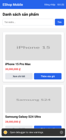
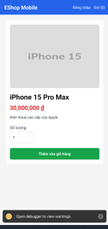

# Hoạt động trên lớp
## Automation testing using Appium and Applitool Eyes(optional)

### Cài đặt môi trường 

Cài đặt các thư viện + môi trường test, chạy backend, frontend-mobile: Xem hướng dẫn cài đặt ở https://github.com/d1nhnguyen/t03_mobile_automation_testing/blob/main/User_Guide.md

### Yêu cầu: Kiểm thử tính năng xem chi tiết sản phẩm. 

Bài test mẫu đang giả định có cấu trúc dạng

eshop-sut  
src/appium/  
├── config/  
│   ├── session.js  
│   └── ...  
├── tests/  
│   └── example.test.js  
├── .env  
├── package.json  
└── package-lock.json  

#### Appium
- Hướng dẫn
Tạo file /src/appium/config/session.js

```JavaScript
const path = require("node:path");
const { remote } = require("webdriverio");

const defaultApk = path.resolve(
  __dirname,
  "../../../eshop-sut/frontend-mobile/android/app/build/outputs/apk/debug/app-debug.apk",
);

async function createSession() {
  const capabilities = {
    platformName: "Android",
    "appium:automationName": "UiAutomator2",
    "appium:deviceName": process.env.ANDROID_DEVICE_NAME || "Android Emulator",
    "appium:app": process.env.ESHOP_APK_PATH || defaultApk,
    "appium:appPackage": "com.eshop.sut",
    "appium:noReset": false,
  };

  if (process.env.ANDROID_UDID) {
    capabilities["appium:udid"] = process.env.ANDROID_UDID;
  }

  return remote({
    hostname: process.env.APPIUM_HOST || "127.0.0.1",
    port: Number(process.env.APPIUM_PORT || 4723),
    path: "/",
    logLevel: "error",
    capabilities,
  });
}

module.exports = { createSession };
```

- Sửa template render của Screen. Thêm testId vào 
```JavaScript
<TouchableOpacity
  style={[styles.secondaryButton, styles.actionFlex]}
  onPress={() => openProductDetail(item.id)}
>
  <Text style={styles.secondaryButtonText}>Xem chi tiết</Text>
</TouchableOpacity>
```
thành

```JavaScript
<TouchableOpacity
  style={[styles.secondaryButton, styles.actionFlex]}
  onPress={() => openProductDetail(item.id)}
  testID={`product-detail-${item.id}`}
>
  <Text style={styles.secondaryButtonText}>Xem chi tiết</Text>
</TouchableOpacity>
```

- Sửa template render Product detail. Thêm testId vào
```JavaScript
          <TouchableOpacity
            style={styles.greenButton}
            onPress={() => {
              addToCart(product, quantity);
              setAdded(true);
              setClickCount(0);
              setTimeout(() => setAdded(false), 2000);
            }}
          >
            <Text style={styles.buttonText}>
              {added ? "Đã thêm" : "Thêm vào giỏ hàng"}
            </Text>
          </TouchableOpacity>
```

thành

```JavaScript
          <TouchableOpacity
            style={styles.greenButton}
            onPress={() => {
              addToCart(product, quantity);
              setAdded(true);
              setClickCount(0);
              setTimeout(() => setAdded(false), 2000);
            }}
            testID={'add-to-cart-pd'}
          >
            <Text style={styles.buttonText}>
              {added ? "Đã thêm" : "Thêm vào giỏ hàng"}
            </Text>
          </TouchableOpacity>

```

và
```JavaScript
<Text style={styles.detailName}>{product.name}</Text>
<Text style={styles.detailPrice}>{formatMoney(product.price)}</Text>
```

thành

```JavaScript
<Text style={styles.detailName} testID={'product-detail-name'}>{product.name}</Text>
<Text style={styles.detailPrice} testID={'product-detail-price'}>{formatMoney(product.price)}</Text>
```

- Sửa renderHeader
```JavaScript
<Text style={styles.navText}>Giỏ ({cart.length})</Text>
```

thành
```JavaScript
<Text style={styles.navText} testID={'product-cart'}>Giỏ ({cart.length})</Text>
```


- File test mẫu: example.test.js
```JavaScript
const assert = require("node:assert/strict");
const test = require("node:test");
const { createSession } = require("../config/session");

test("EShop: Xem chi tiết và thêm vào giỏ", { timeout: 180_000 }, async () => {
  let driver;
  try {
    driver = await createSession();
    const byId = (id) => driver.$(`android=new UiSelector().resourceId("${id}")`);
    const detailBtn = await byId('product-detail-1');
    await detailBtn.waitForDisplayed({ timeout: 30000 });
    await detailBtn.click();
    // Kiểm tra tên, giá sản phẩm
    const productName = await byId('product-detail-name');
    const productPrice = await byId('product-detail-price');
    const cartButton = await byId('product-cart');
    const productAdd = await byId('add-to-cart-pd');

    await productName.waitForDisplayed({ timeout: 10_000});
    await productPrice.waitForDisplayed({ timeout: 10_000});
    await cartButton.waitForDisplayed({ timeout: 10_000});
    await productAdd.waitForDisplayed({ timeout: 10_000});

    assert.equal(await productName.getText(), "iPhone 15 Pro Max" );
    assert.equal((await productPrice.getText()).replace(/\D/g, ""), "30000000" );

    // Kiểm tra số lượng sản phẩm sau khi thêm 1 sản phẩm
    const cartText = await cartButton.getText();
    const count = Number(cartText.match(/\d+/)[0]);
    await productAdd.click();

    const okButton = await driver.$('android=new UiSelector().text("OK")');

    await okButton.waitForDisplayed({ timeout: 5000 });
    await okButton.click();

    cardButton = await byId('product-cart')
    const newCartText = await cartButton.getText();
    const newCount = Number(newCartText.match(/\d+/)[0]);
    assert.equal(count + 1, newCount);
  }
  finally{
    if (driver) await driver.deleteSession();
  }
});
```

Chạy test bằng lệnh sau:
```bash
cd src/appium
node --test tests/example.test.js
```

Các bạn viết các test case sau

| STT | Mô tả | Input | Step | Expected Output |
|---:|---|---|---|---|
| 1 | Thêm sản phẩm vào giỏ hàng với số lượng bằng 0 | Số lượng: `0` | 1. Bấm **Xem chi tiết**.<br>2. Nhập `0` vào ô số lượng.<br>3. Bấm **Thêm vào giỏ hàng**. | Hệ thống hiển thị thông báo lỗi số lượng không hợp lệ hoặc ngăn người dùng nhập số 0. |
| 2 | Thêm sản phẩm vào giỏ hàng với số lượng là số thập phân | Số lượng: `8.9` | 1. Bấm **Xem chi tiết**.<br>2. Nhập `8.9` vào ô số lượng.<br>3. Bấm **Thêm vào giỏ hàng**. | Hệ thống hiển thị thông báo lỗi số lượng không hợp lệ hoặc ngăn người dùng nhập số thập phân. |
| 3 | Thêm sản phẩm vào giỏ hàng với số lượng cực lớn | Số lượng: `99999999999999999999999999999999999999999999999999999999999999999` | 1. Bấm **Xem chi tiết**.<br>2. Nhập số lượng đã cho vào ô số lượng.<br>3. Bấm **Thêm vào giỏ hàng**. | Hệ thống thông báo số lượng không hợp lệ hoặc giới hạn số lượng chữ số được phép nhập, đồng thời không thêm sản phẩm với số lượng không hợp lệ vào giỏ hàng. |

Đây là hình ảnh màn hình từng step:   
  

* **Lưu ý** Phần code test mẫu là đang sử dụng số lượng mặc định là 1. Do đó, code test mẫu không có phần tìm ô chứa số lượng và nhập vào.  
Vì vậy, khi viết các test khác các bạn phải thêm testID vào thẻ html của ô nhập số lượng nếu muốn dùng resource-id và tự viết tìm ô số lượng cũng như nhập số lượng trong test.  

#### Applitool Eyes

Thêm cấu hình applitool eyes cho file test mẫu
```JavaScript
const { Eyes, ClassicRunner, Target } = require("@applitools/eyes-webdriverio");
const assert = require("node:assert/strict");
const test = require("node:test");
const { createSession } = require("../config/session");

const runner = new ClassicRunner();
const eyes = new Eyes(runner);

eyes.setApiKey(process.env.APPLITOOLS_API_KEY);

test("EShop: Xem chi tiết và thêm vào giỏ", { timeout: 180_000 }, async () => {
  let driver;
  try {
    driver = await createSession();
    await eyes.open(driver, "EShop", "Product Detail Flow");
    const byId = (id) => driver.$(`android=new UiSelector().resourceId("${id}")`);
    // Checkpoint 1
    await eyes.check("Home Screen", Target.window());
    const detailBtn = await byId('product-detail-1');
    await detailBtn.waitForDisplayed({ timeout: 30000 });
    await detailBtn.click();
    // Kiểm tra tên, giá sản phẩm
    const productName = await byId('product-detail-name');
    const productPrice = await byId('product-detail-price');
    const cartButton = await byId('product-cart'); 
    const productAdd = await byId('add-to-cart-pd');

    await productName.waitForDisplayed({ timeout: 10_000});
    await productPrice.waitForDisplayed({ timeout: 10_000});
    await cartButton.waitForDisplayed({ timeout: 10_000});
    await productAdd.waitForDisplayed({ timeout: 10_000});
    // Checkpoint 2
    await eyes.check("Product Detail Screen", Target.window());

    assert.equal(await productName.getText(), "iPhone 15 Pro Max" );
    assert.equal((await productPrice.getText()).replace(/\D/g, ""), "30000000" );

    // Kiểm tra số lượng sản phẩm sau khi thêm 1 sản phẩm
    const cartText = await cartButton.getText();
    const count = Number(cartText.match(/\d+/)[0]);
    await productAdd.click();

    const okButton = await driver.$('android=new UiSelector().text("OK")');

    await okButton.waitForDisplayed({ timeout: 5000 });
    await okButton.click();

    cardButton = await byId('product-cart')
    const newCartText = await cartButton.getText();
    const newCount = Number(newCartText.match(/\d+/)[0]);
    assert.equal(count + 1, newCount);
    // Checkpoint 3
    await eyes.check("After Add Screen", Target.window());
    await eyes.close();
  }
  finally{
    if (driver) await driver.deleteSession();
  }
});
```
Sau khi chạy test lần đầu lên dash board và accept baseline bằng cách nhấn nút 👍 trên dashboard, các lần chạy sau sẽ dựa vào baseline đã accept để so sánh.  
Các bạn có thể sử dụng các cấu hình nâng cao như Strict, Layout để tăng độ chính xác. 
Chạy export APPLITOOLS_API_KEY="api_key" trước khi chạy test hoặc có thể cấu hình dotenv nếu muốn. 
