# Diff Cards — Câu hỏi và đáp án

Bản đầy đủ: mỗi thẻ có ảnh so sánh, ngữ cảnh release, ảnh diff của công cụ, đáp án và lý do.

Trong ảnh thẻ: **trái là baseline, phải là bản mới**. Trong ảnh diff: vùng **hồng/tím** là vùng công cụ đánh dấu khác biệt. Toast "Open debugger to view warnings." có ở cả hai bên mọi thẻ nên không tạo ra khác biệt.

Giữ nguyên thư mục `diff-cards/` (có `questions/` và `answers/`) để ảnh hiển thị đúng.

## Bảng đáp án nhanh

| Thẻ | Màn hình | Đáp án | Nhóm |
|---|---|---|---|
| 1 | Danh sách sản phẩm | **Reject** | Lỗi thật |
| 2 | Giỏ hàng | **Reject** | Lỗi thật (assert chữ vẫn qua) |
| 3 | Danh sách sản phẩm | **Accept** | Có chủ đích |
| 4 | Danh sách sản phẩm | **Accept** | Có chủ đích |
| 5 | Danh sách sản phẩm | **Chưa đủ thông tin** (mặc định Reject phần ngoài ticket) | Mơ hồ |
| 6 | Giỏ hàng | **Reject** | Lỗi thật (một phần có chủ đích, một phần là lỗi) |
| 7 | Đăng nhập | **Accept** | Có chủ đích |
| 8 | Danh sách sản phẩm | **Accept cùng thẻ 7** | Nhiễu dây chuyền (cùng nguyên nhân gốc với thẻ 7) |
| 9 | Giỏ hàng | **Chưa đủ thông tin** | Mơ hồ |
| 10 | Danh sách sản phẩm | **Reject** | Lỗi thật: giá sai nhưng khác biệt hình ảnh rất nhỏ, dễ bị cho qua |

Phân bố: 4 lỗi thật (1, 2, 6, 10), 3 có chủ đích (3, 4, 7), 1 nhiễu dây chuyền (8), 2 mơ hồ (5, 9). Thẻ 10 là thẻ "giá sai nhưng visual dễ bị cho qua".

**Về cân đối:** bộ ảnh hiện có không chứa thẻ nhiễu thuần (khác biệt do thiết bị hoặc render, không do thay đổi sản phẩm), nên mục "nhiễu" chỉ có thẻ 8. Nếu cần đủ 3 thẻ nhiễu, nên chụp thêm: một thẻ chỉ lệch giờ ở status bar, một thẻ chụp khi ảnh sản phẩm chưa tải xong, một thẻ lệch khử răng cưa chữ.

---

## Thẻ 1

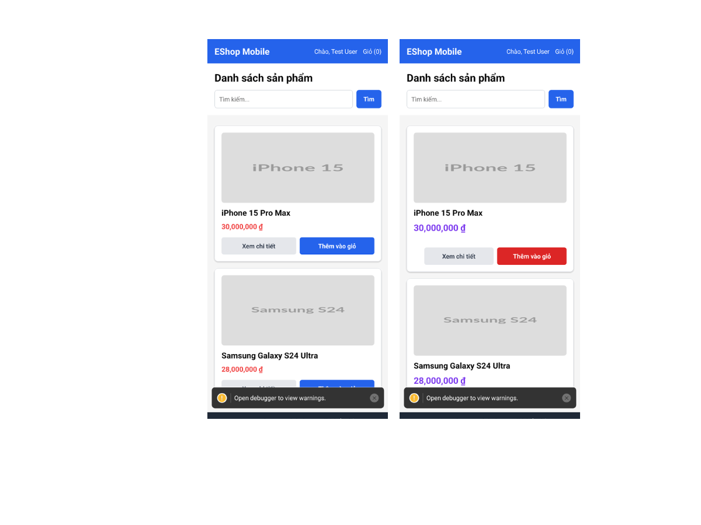

**Ngữ cảnh release:** Release 2.4.1 chỉ sửa chính tả một số nhãn trong màn Giỏ hàng. Không có thay đổi thiết kế nào ở màn Danh sách sản phẩm.

**Ảnh diff của công cụ:**

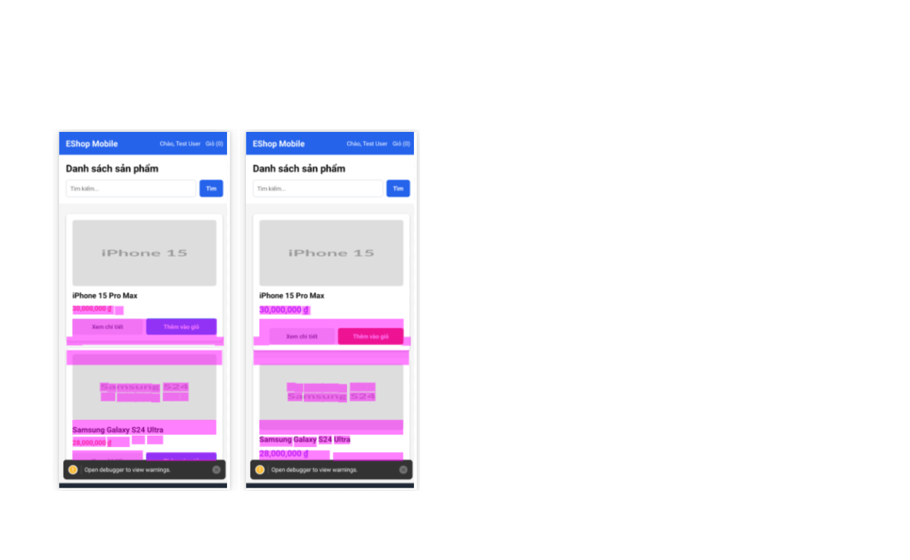

**Đáp án: Reject (lỗi thật).**

**Lý do:**
- Bản mới đổi giá sang màu tím và chữ to hơn, hai nút "Xem chi tiết" / "Thêm vào giỏ" bị đẩy xuống và sang phải, nút "Thêm vào giỏ" đổi từ xanh sang đỏ.
- Không thay đổi nào trong số này nằm trong phạm vi release (chỉ sửa chính tả ở màn khác).
- Việc đẩy layout xuống làm cả thẻ sản phẩm thứ hai bị lệch theo, nên diff đánh dấu nhiều vùng; nguyên nhân gốc chỉ là các thay đổi style ở thẻ đầu.
- Tên và giá vẫn đúng chữ, nên kiểm tra chữ (assert) vẫn qua; chỉ kiểm tra hình ảnh bắt được.

---

## Thẻ 2

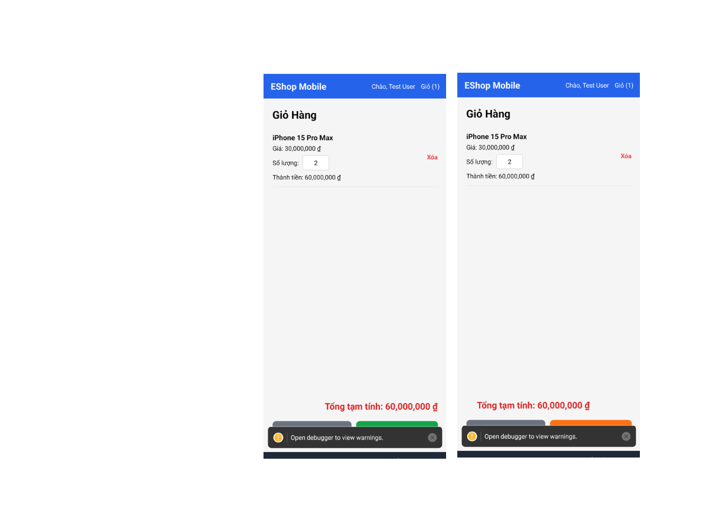

**Ngữ cảnh release:** Release 2.4.1 sửa lỗi làm tròn tổng tiền trong giỏ hàng. Ticket không nhắc thay đổi giao diện nào.

**Ảnh diff của công cụ:**

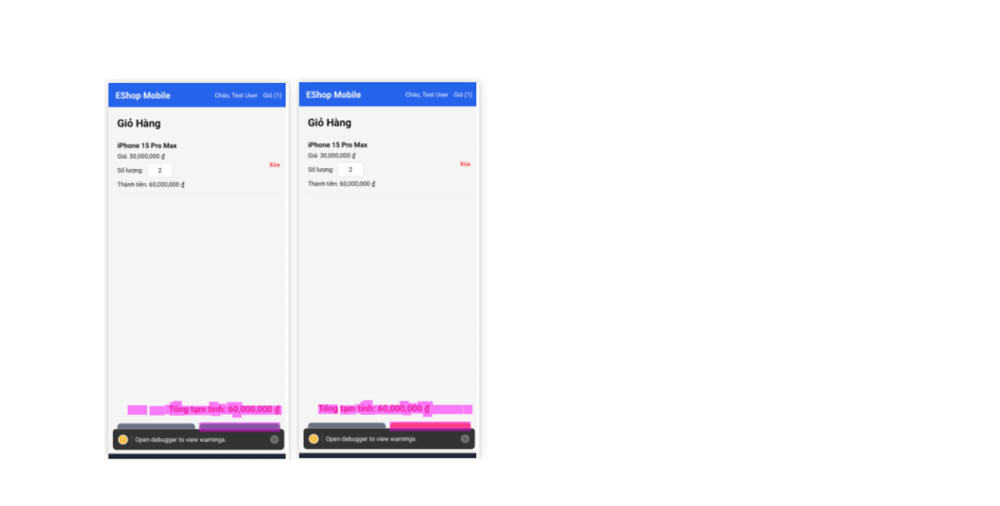

**Đáp án: Reject (lỗi thật).**

**Lý do:**
- Dòng "Tổng tạm tính" chuyển từ căn phải sang căn trái, và nút phía sau đổi từ xanh lá sang cam.
- Ticket chỉ nói về làm tròn số tiền, không nói về căn lề hay màu nút.
- Số tiền hiển thị vẫn là 60,000,000 ₫ ở cả hai bên, nên kiểm tra chữ vẫn qua. Đây là ca điển hình mà kiểm tra chức năng bỏ sót còn kiểm tra hình ảnh bắt được.

---

## Thẻ 3

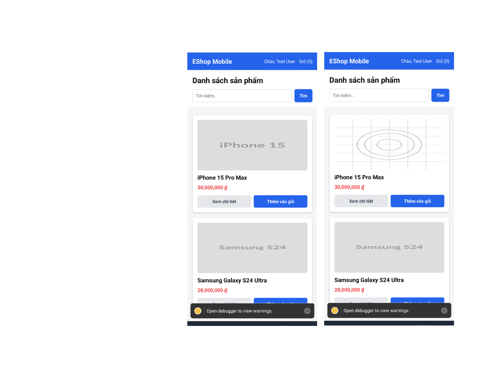

**Ngữ cảnh release:** Release 2.4.2, ticket MKT-118: marketing thay ảnh minh họa của sản phẩm "iPhone 15 Pro Max". Các sản phẩm khác không đổi.

**Ảnh diff của công cụ:**

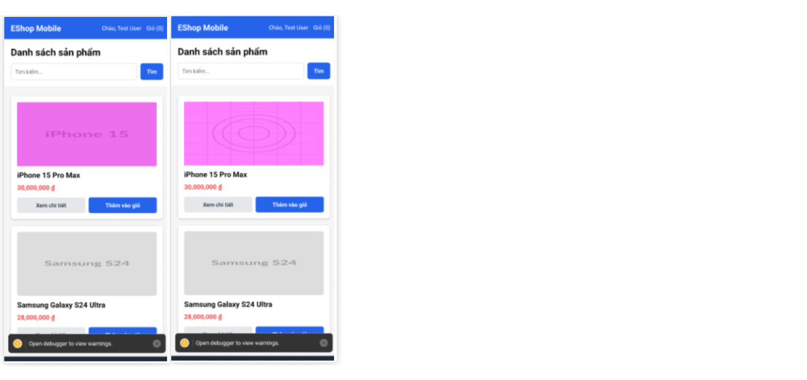

**Đáp án: Accept (có chủ đích).**

**Lý do:**
- Chỉ vùng ảnh của sản phẩm đầu tiên bị đánh dấu, đúng với sản phẩm trong ticket.
- Khung ảnh giữ nguyên kích thước và vị trí; tên, giá, nút và sản phẩm thứ hai không đổi.
- Đây là false positive cần duyệt: công cụ báo khác biệt nhưng thay đổi là hợp lệ. Nếu loại thay đổi này lặp lại thường xuyên, đặt vùng ảnh ở mức so sánh Layout thay vì Accept thủ công mỗi lần.

---

## Thẻ 4

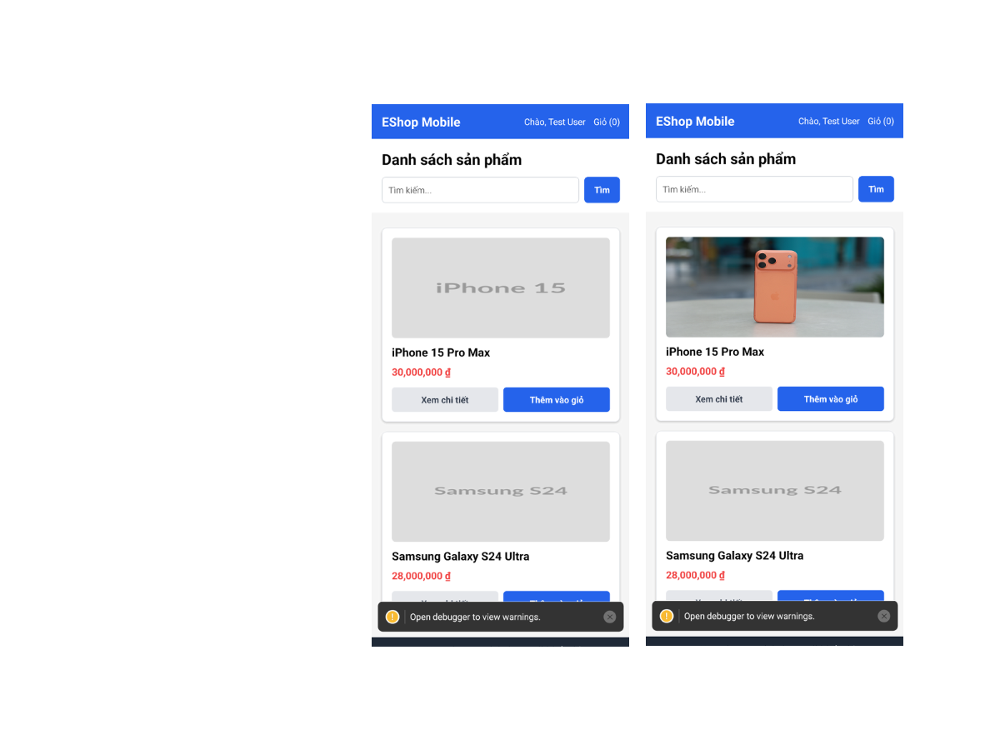

**Ngữ cảnh release:** Release 2.4.2: backend bắt đầu trả ảnh thật cho "iPhone 15 Pro Max"; các sản phẩm còn lại vẫn dùng ảnh tạm.

**Ảnh diff của công cụ:**

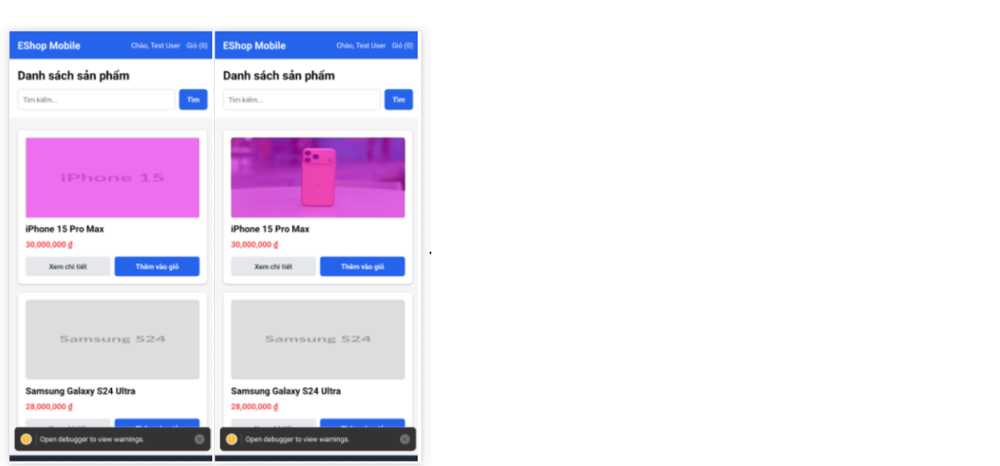

**Đáp án: Accept (có chủ đích).**

**Lý do:**
- Ngữ cảnh nói rõ sản phẩm này chuyển từ ảnh tạm sang ảnh thật; diff chỉ đánh dấu đúng vùng ảnh đó.
- Bố cục không đổi: khung ảnh, tên, giá, nút và sản phẩm thứ hai giữ nguyên.
- Ảnh thật sẽ làm baseline từ nay. Lưu ý: nếu ảnh tải chậm, lần chụp sau có thể rơi lại về ảnh tạm và tạo diff giả; nên chờ ảnh tải xong trước khi chụp.

---

## Thẻ 5

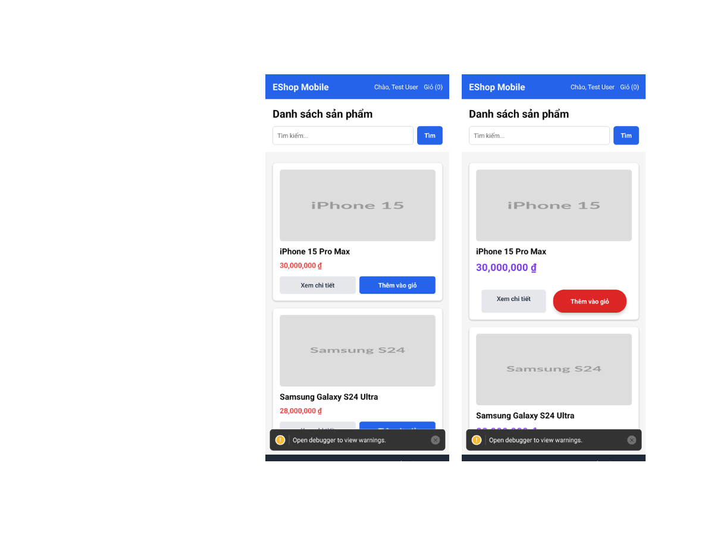

**Ngữ cảnh release:** Release 2.5.0, ticket UI-190: "Cập nhật nút kêu gọi hành động (CTA) theo design system mới". Ticket chưa đính kèm spec chi tiết.

**Ảnh diff của công cụ:**

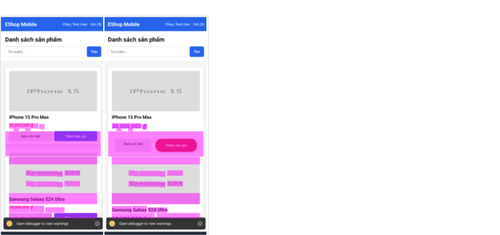

**Đáp án: Chưa đủ thông tin.** Nếu buộc phải quyết định ngay: Reject phần ngoài phạm vi ticket, và hỏi lại người thiết kế trước khi Accept.

**Lý do:**
- Nút "Thêm vào giỏ" chuyển sang đỏ, bo tròn hoàn toàn và có bóng đổ: có thể thuộc phạm vi "cập nhật nút CTA".
- Nhưng giá cũng đổi sang màu tím và to hơn, và hàng nút bị đẩy xuống và sang phải. Ticket chỉ nói về nút CTA, không nói về giá hay vị trí.
- Không có spec nên không xác định được phần nào là thiết kế, phần nào là lỗi style rò rỉ. Cần hỏi: design system mới quy định màu và cỡ chữ giá không, và vị trí hàng nút có thay đổi không.
- Một câu trả lời tốt nêu rõ cần hỏi gì, thay vì Accept cả thẻ.

---

## Thẻ 6

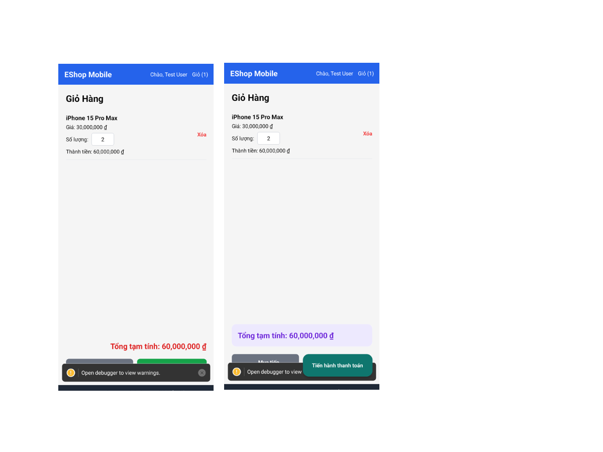

**Ngữ cảnh release:** Release 2.5.0, ticket CART-77: làm nổi bật dòng "Tổng tạm tính" trong Giỏ hàng. Ticket không nhắc đến các nút ở cuối màn hình.

**Ảnh diff của công cụ:**

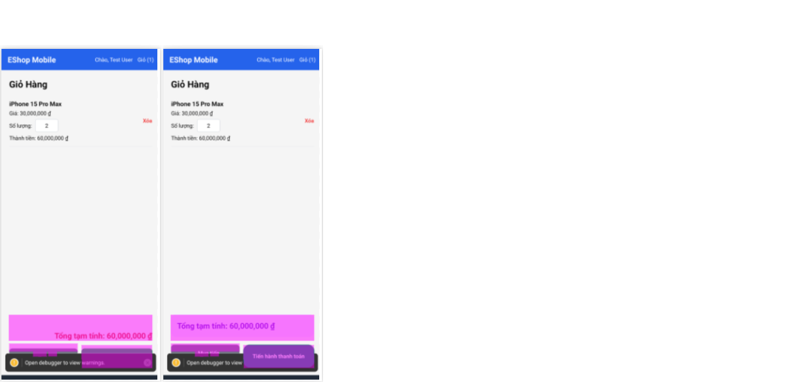

**Đáp án: Reject (lỗi thật).**

**Lý do:**
- Phần dòng tổng tiền nằm trong khung nền tím nhạt là đúng ý ticket ("làm nổi bật").
- Tuy nhiên nút "Tiến hành thanh toán" đã đổi sang màu xanh ngọc và nằm đè lên nút "Mua tiếp" (chữ nút bên trái bị che một phần), đồng thời chồng lên toast. Ticket không yêu cầu thay đổi này.
- Một nút bị che là lỗi sử dụng thật, không phải thay đổi thẩm mỹ. Cách xử lý: Reject cả thẻ, ghi rõ phần tổng tiền là hợp lệ để dev chỉ sửa phần nút.

---

## Thẻ 7

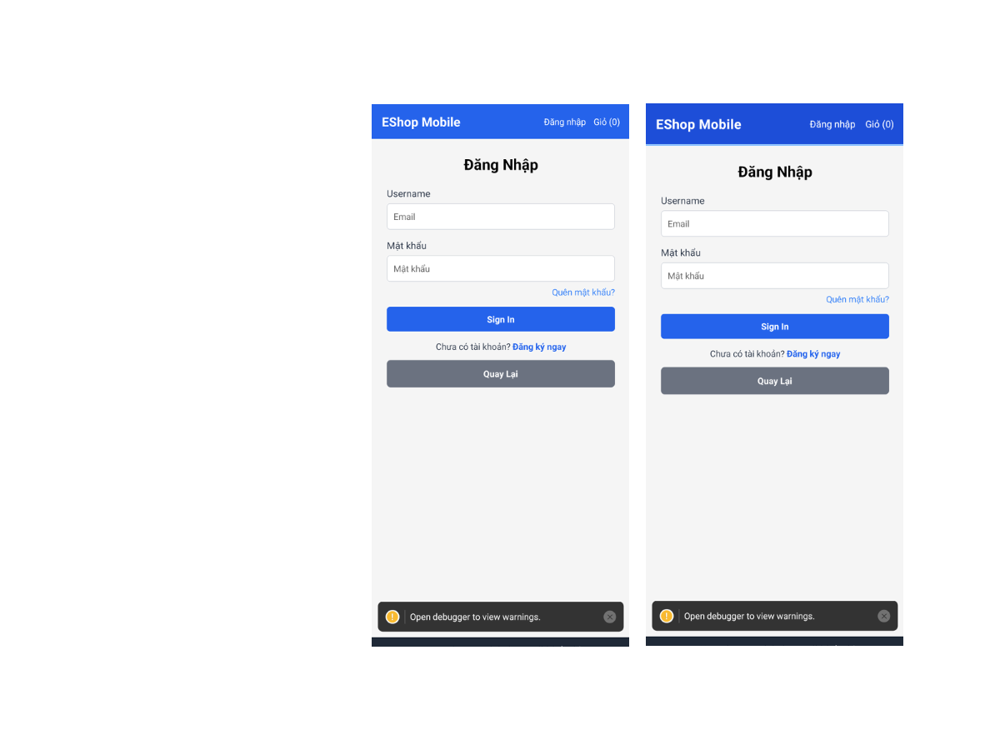

**Ngữ cảnh release:** Release 2.6.0, ticket UI-204: làm mới thanh điều hướng theo brand mới (xanh đậm hơn, cao hơn một chút). Màn hình trong ảnh: Đăng nhập.

**Ảnh diff của công cụ:**

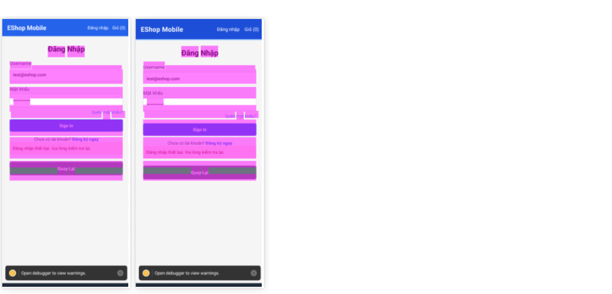

**Đáp án: Accept (có chủ đích).**

**Lý do:**
- Bản mới có thanh điều hướng xanh đậm hơn và cao hơn một chút, đúng với ticket UI-204. Toàn bộ nội dung phía dưới bị đẩy xuống theo.
- Vì thanh điều hướng cao hơn, mọi phần tử bên dưới dịch xuống nên diff đánh dấu gần hết màn hình, dù nội dung form không đổi.
- Quyết định đúng là Accept dựa trên ticket, không dựa vào lượng vùng bị tô.

**Lưu ý về tư liệu:** ảnh diff của thẻ này cho thấy form đã nhập email và hiển thị thông báo lỗi đăng nhập, trong khi ảnh thẻ cho thấy form trống. Hai ảnh không cùng trạng thái màn hình; nên chụp lại ảnh diff cùng trạng thái với ảnh thẻ trước khi in.

---

## Thẻ 8

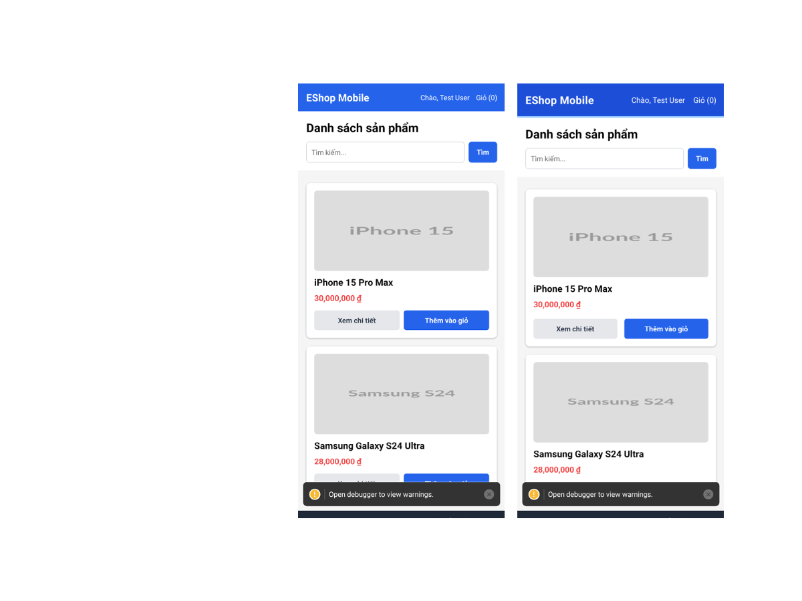

**Ngữ cảnh release:** Cùng Release 2.6.0 với thẻ 7. Màn hình trong ảnh: Danh sách sản phẩm. Công cụ so sánh đánh dấu gần như toàn bộ trang.

**Ảnh diff của công cụ:**

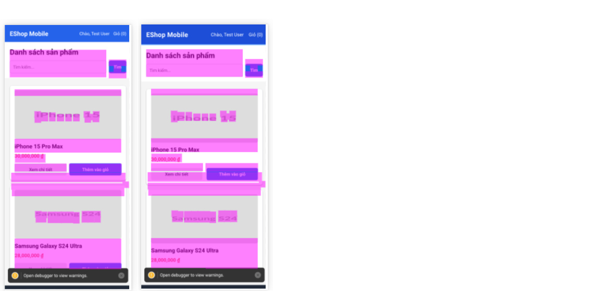

**Đáp án: Accept cùng thẻ 7 (nhiễu dây chuyền).**

**Lý do:**
- Nguyên nhân gốc duy nhất là thanh điều hướng mới cao hơn, đúng với ticket UI-204 đã duyệt ở thẻ 7.
- Mọi thứ phía dưới (tiêu đề, ô tìm kiếm, thẻ sản phẩm, ảnh, giá, nút) chỉ dịch xuống theo, nên diff tô gần hết trang dù nội dung không đổi.
- Không nên duyệt từng vùng; cần nhận ra đây là một nguyên nhân gốc, duyệt một lần cùng thẻ 7. Nên kiểm tra nhanh rằng ngoài độ dịch xuống thì không có gì khác (giá, chữ, màu nút đều giữ nguyên).

---

## Thẻ 9

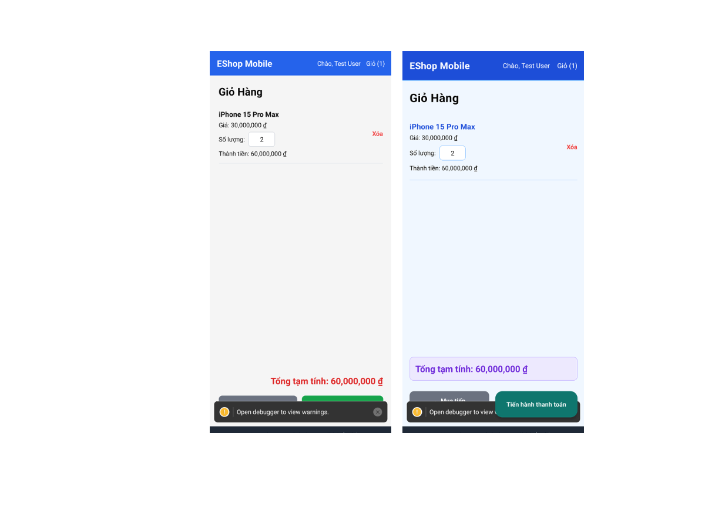

**Ngữ cảnh release:** Release 2.6.0, ticket UI-210: "Làm mới màn Giỏ hàng". Ticket chưa có ảnh thiết kế đính kèm.

**Ảnh diff của công cụ:**

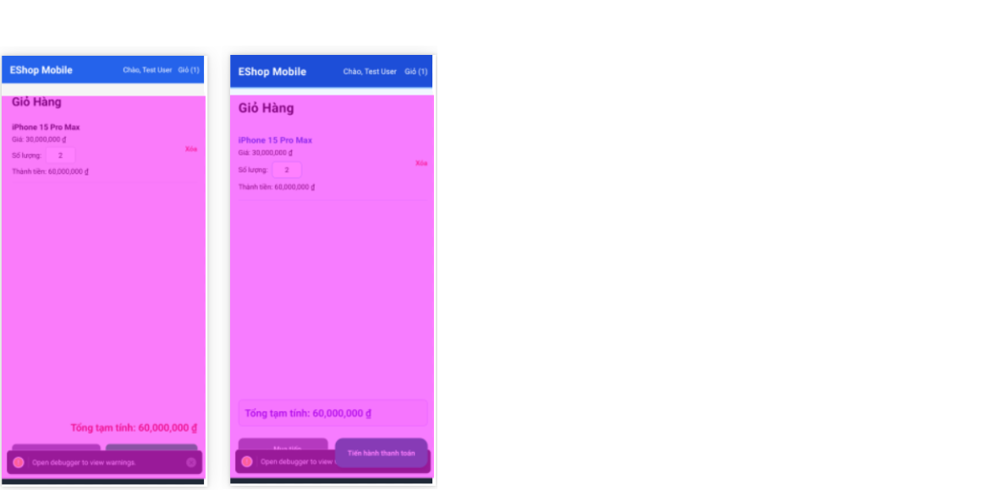

**Đáp án: Chưa đủ thông tin.** Không nên Accept cả thẻ khi chưa có thiết kế.

**Lý do:**
- Màn hình đổi gần như toàn bộ: nền xanh nhạt, tên sản phẩm màu xanh, ô số lượng có viền xanh, tổng tiền trong khung tím, nút thanh toán xanh ngọc. Ticket "làm mới" đủ rộng để bao hàm phần lớn các thay đổi này.
- Nhưng nút "Tiến hành thanh toán" đè lên nút "Mua tiếp" và toast, giống lỗi ở thẻ 6, không rõ là thiết kế hay lỗi.
- Vì diff tô toàn bộ màn hình, không thể tách phần nào hợp lệ theo vùng. Cần hỏi: (1) có bản thiết kế để đối chiếu không, (2) vị trí nút thanh toán chồng lên nút "Mua tiếp" có đúng thiết kế không.
- Cách xử lý đề xuất: giữ ở trạng thái chờ, không Accept; tách riêng việc kiểm tra phần nút chồng lấn.

---

## Thẻ 10

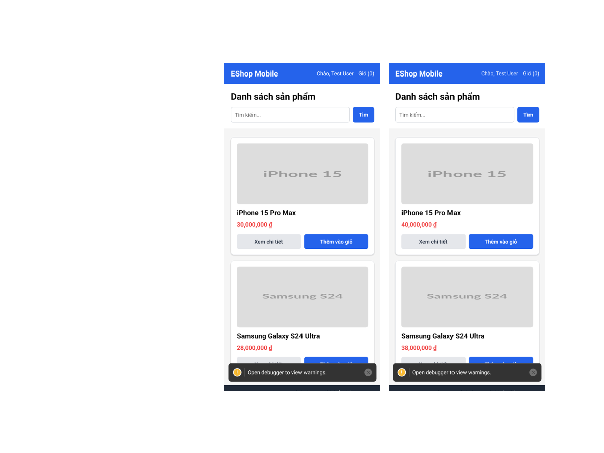

**Ngữ cảnh release:** Release 2.6.1 chỉ chỉnh khoảng cách bên trong thẻ sản phẩm. Giá niêm yết không thay đổi (iPhone 15 Pro Max vẫn 30,000,000 ₫).

**Ảnh diff của công cụ:**

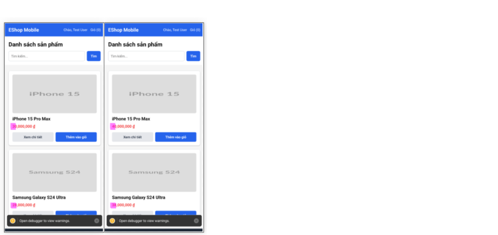

**Đáp án: Reject (lỗi thật), thẻ "giá sai nhưng khác biệt hình ảnh rất nhỏ".**

**Lý do:**
- Bố cục, màu, ảnh, nút giữ nguyên. Chỉ giá thay đổi: iPhone 15 Pro Max từ 30,000,000 ₫ lên 40,000,000 ₫, Samsung Galaxy S24 Ultra từ 28,000,000 ₫ lên 38,000,000 ₫.
- Ngữ cảnh khẳng định giá niêm yết không đổi, nên đây là lỗi dữ liệu hiển thị, mức độ nghiêm trọng cao (giá sai ảnh hưởng trực tiếp đến thanh toán).
- Công cụ chỉ tô một vùng rất nhỏ ở chữ số đầu của mỗi giá, rất dễ bị lướt qua hoặc bị Accept nhầm; nếu so sánh ở mức Layout (chỉ bố cục) thì cả thẻ sẽ qua mà không báo gì.
- Cách bắt chắc chắn là kiểm tra chữ (assert) trên giá của từng sản phẩm. Bài học: kiểm tra hình ảnh không thay thế kiểm tra chức năng cho dữ liệu quan trọng như giá.
