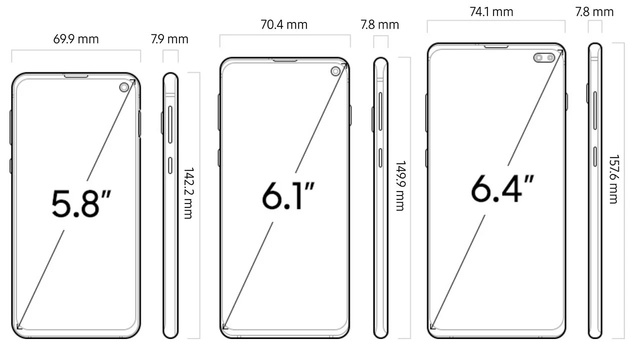
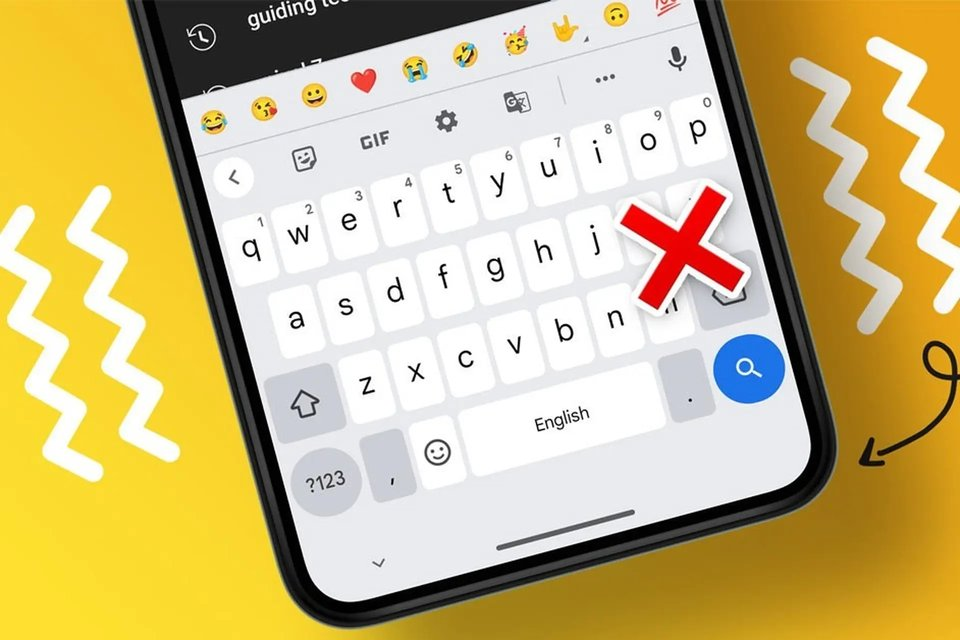
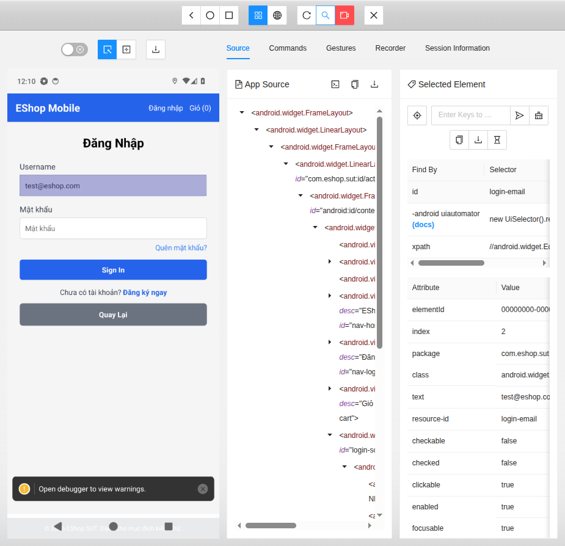
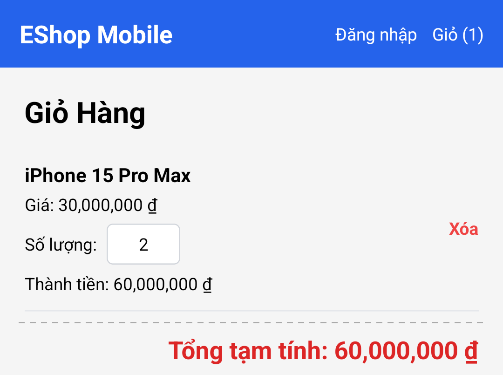
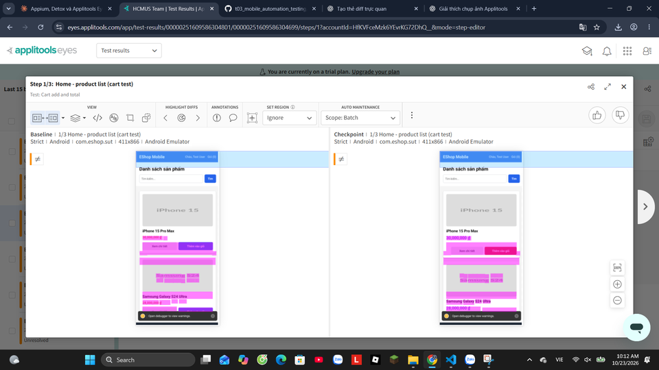

<!-- _class: title -->
<!-- _header: "" -->
<!-- _footer: "" -->
<div class="tl">
<div class="big">T03</div>
<div class="members"><b>Danh sách thành viên:</b>23120027 - Nguyễn Hải Đăng<br>23120031 - Nguyễn Phú Dinh<br>23120034 - Ứng Thị Thuỳ Dương</div>
<div class="foot">2026 AI-First · CS423/CSC15003</div>
</div>
<div class="tr">
<h1>Mobile Automation Testing với Appium 2 và Applitools Eyes</h1>
<div class="logos"></div>
<div class="band light">DEMO: Appium 2 + UiAutomator2 (truyền thống) · Applitools Eyes (AI visual)</div>
<div class="vlink">
Video demo: <a href="https://youtu.be/N3cN5d2LSG4">https://youtu.be/N3cN5d2LSG4</a><br>
<span class="small">Video theo phần (cài đặt · Record · Data-driven · Eyes): <code>Demo_Video_Links.md</code> · Hướng dẫn chạy lại: <code>User_Guide.md</code></span>
</div>
</div>

---

<!-- _footer: "2 · Kiểm thử mobile là gì" -->
# Kiểm thử mobile là gì và khác web thế nào?

<div class="def"><b>Kiểm thử ứng dụng mobile</b> là kiểm tra app chạy trên điện thoại, máy tính bảng để xác nhận app <b>làm đúng</b>, <b>hiển thị đúng</b> và <b>dùng được</b> trong điều kiện thật: nhiều loại máy, nhiều phiên bản OS, mạng chập chờn, bị gián đoạn. Mục tiêu giống kiểm thử phần mềm nói chung, nhưng trên mobile <b>môi trường là một phần của bài test</b>.</div>

| Đặc trưng | Mobile | Web / desktop thường |
|---|---|---|
| Phân mảnh máy + OS + DPI / OEM | Rất mạnh | Ít hơn (vài browser / vài OS) |
| Tương tác | Touch, swipe, long-press, bàn phím ảo che UI | Click, hover, bàn phím vật lý |
| Vòng đời app | Background, bị OS kill, xoay màn, mở lại giữa chừng | Tab / cửa sổ thường sống lâu |
| Gián đoạn | Gọi, noti, chuyển app — phải xét phục hồi | Hiếm là hạng mục riêng |
| Mạng | Wi‑Fi ↔ 4G, mất sóng, offline, sync lại | Thường giả định có mạng |
| Quyền, cảm biến, pin | Runtime permission, GPS/camera, pin | Hạn chế hơn (sandbox trình duyệt) |
| Phát hành | Store; máy giữ bản cũ lâu | Deploy server / installer |

- Cùng locator đúng vẫn có thể fail khi bàn phím che nút, cold start chưa lên foreground, hoặc baseline Eyes gắn nhầm AVD.
- Buổi demo đi sâu **chức năng** và **visual**; các hạng mục còn lại nằm ngoài phạm vi chạy thật.

 &nbsp;&nbsp; 

---

<!-- _footer: "3 · Các lớp kiểm thử" -->
# Kiểm thử mobile gồm những lớp nào?

<div class="two">
<div>
<div class="band">Phạm vi thường gặp</div>

| Khía cạnh | Câu hỏi ngắn |
|---|---|
| Chức năng | Luồng nghiệp vụ đúng chưa? |
| Giao diện / visual | Còn giống thiết kế không? |
| Tương thích | Máy / OS / độ phân giải? |
| Hiệu năng, pin, mạng | Chậm, tốn pin, mạng yếu? |
| Gián đoạn | Gọi, noti, chuyển nền? |
| Cài đặt / quyền | Cài mới, cập nhật, cấp quyền? |
| Usability / ability, bảo mật | Dễ dùng? An toàn? |

</div>
<div>
<div class="band red">Hai lớp trong demo T03</div>

| | Functional | Visual |
|---|---|---|
| Hỏi | App **làm** đúng không? | App **trông** đúng không? |
| Chuẩn so | Giá trị kỳ vọng trong code | Ảnh baseline đã duyệt |
| Công cụ | Appium | Applitools Eyes |

- Functional pass chưa đủ để kết luận giao diện đúng
- Visual pass chưa đủ để kết luận dữ liệu đúng
- Hai lớp bổ sung nhau trên cùng luồng EShop

</div>
</div>

---

<!-- _footer: "4 · Mobile Automation Testing" -->
# Mobile Automation Testing là gì?

<div class="def">Dùng một <b>chương trình (test script)</b> điều khiển app trên emulator hoặc thiết bị thật: lặp lại thao tác của người dùng, rồi <b>tự so kết quả với kỳ vọng</b>. Kết quả Pass / Fail lặp lại được, không phụ thuộc người bấm.</div>

<div class="two">
<div>
<div class="band">Vị trí trong kim tự tháp kiểm thử</div>

| Tầng | Đặc điểm | Trên EShop |
|---|---|---|
| E2E qua giao diện (ít) | Chậm, dễ nhiễu; lớp duy nhất xác nhận **người dùng làm được việc** | **Appium + Eyes** |
| Component / API | Nhanh hơn, không cần thiết bị | Jest (ngoài phạm vi) |
| Unit (nhiều) | Nhanh, rẻ, ổn định | Jest (ngoài phạm vi) |

</div>
<div>
<div class="band red">Nên tự động khi nào?</div>

| Nên tự động | Nên làm thủ công |
|---|---|
| Hồi quy sau mỗi thay đổi | Kiểm thử khám phá |
| Một kịch bản, nhiều bộ dữ liệu | Đánh giá dễ dùng, cảm nhận |
| Nhiều máy / OS | Ca chỉ chạy một lần |
| So giao diện giữa các bản | Màn hình còn đổi liên tục |

</div>
</div>

---

<!-- _footer: "5 · Lợi ích và cái giá" -->
# Lợi ích và cái giá, đo trên EShop

| Lợi ích | Cái giá |
|---|---|
| 8 check chạy lại trong ~102 s, không cần người bấm | Phải bảo trì locator khi UI đổi |
| Thêm một ca = thêm một dòng dữ liệu | Phải chờ UI bất đồng bộ (wait theo điều kiện) |
| Eyes bắt lỗi giao diện mà assert bỏ sót (V2) | Baseline cần người duyệt; một lượt Eyes ~191–210 s |


---

<!-- _footer: "6 · Quy trình automation" -->
# Quy trình một vòng kiểm thử tự động trên mobile


<div class="proc">
<div class="box"><span class="n">1</span><b>Chuẩn bị môi trường</b>Android SDK, emulator, APK, backend + dữ liệu mẫu</div>
<div class="box"><span class="n">2</span><b>Làm app kiểm thử được</b>Đặt <code>testID</code> ổn định, dữ liệu seed, cách reset</div>
<div class="box"><span class="n">3</span><b>Thiết kế ca kiểm thử</b>Kịch bản, bảng dữ liệu, kỳ vọng / baseline</div>
<div class="box"><span class="n">4</span><b>Viết script</b>Locator → action → wait → assert → checkpoint</div>
<div class="box"><span class="n">5</span><b>Chạy &amp; đọc kết quả</b>Pass/Fail trên terminal, dashboard Eyes</div>
<div class="box"><span class="n">6</span><b>Triage &amp; bảo trì</b>Lỗi thật / đổi chủ đích / nhiễu; sửa locator, baseline</div>
</div>

<p class="loop">↺ Mỗi lần app đổi → lặp lại bước 4–6</p>

<div class="band green">Bước 2 thường bị bỏ qua nhưng quyết định độ bền của test: app không có <code>testID</code> thì phải dùng text hoặc XPath, dễ gãy.</div>

---

<!-- _footer: "7 · Khảo sát công cụ" -->
# Khảo sát công cụ — truyền thống và AI-augmented

<div class="two">
<div>
<div class="band">Truyền thống</div>

**Appium 2** — chuẩn WebDriver, đứng ngoài app, Android + iOS, không cần mã nguồn. ✅ **chọn làm lớp functional**

**Espresso** — chạy trong app, nhanh, chỉ Android, viết Kotlin. ✗

**Detox** — cho React Native, tự đồng bộ animation/network, cần build riêng. **Đã chạy thử cùng kịch bản: 3/3 lượt pass.** Hợp khi đội RN chỉ cần CI nhanh.

</div>
<div>
<div class="band red">AI-augmented</div>

**Applitools Eyes** — so ảnh với baseline bằng Visual AI, có ignore/layout region và dashboard duyệt. ✅ **chọn làm lớp visual**

**Maestro + AI assertion** — flow YAML, `assertWithAI` bằng LLM, không có baseline, không lịch sử duyệt. Dự phòng.

</div>
</div>

<div class="band green">Vì sao ghép Appium + Eyes</div>

Eyes gắn vào **cùng một session** Appium: assert chức năng và checkpoint visual chạy trên cùng luồng, cùng APK người dùng cài.

---

<!-- _footer: "8 · Appium là gì" -->
# Appium là gì?

**Appium** là framework mã nguồn mở dùng để tự động hóa kiểm thử giao diện ứng dụng mobile thông qua các test script.

## Có thể làm gì?

- Tự động mở ứng dụng, nhập dữ liệu, nhấn nút.
- Tìm các thành phần giao diện và kiểm tra kết quả.
- Hỗ trợ Android và iOS thông qua các driver tương ứng.

## Hoạt động thế nào?

<div class="flow">
<div class="box"><b>1 · Test Script</b>WebdriverIO: nhập "iPhone" → nhấn Tìm → kiểm tra</div>
<div class="arr">➜<small>W3C WebDriver</small></div>
<div class="box"><b>2 · Appium Server 2.x</b>Nhận lệnh, tạo session, chọn driver</div>
<div class="arr">➜</div>
<div class="box"><b>3 · UiAutomator2</b>Driver Android, cài riêng bằng <code>appium driver install uiautomator2</code></div>
<div class="arr">➜</div>
<div class="box"><b>4 · Emulator + EShop</b>Server trên máy làm thao tác, trả kết quả</div>
</div>

<span class="small">Từ <b>Appium 2</b>, driver tách khỏi lõi: Android dùng <b>UiAutomator2</b>, iOS dùng <b>XCUITest</b>. Phiên bản dùng trong demo: Appium 2.19.0, UiAutomator2 4.2.9.</span>

---

<!-- _footer: "9 · Ba khối nền tảng" -->
# Ba khối nền tảng trong demo Appium


<div class="three">
<div class="box"><b><span class="n">1</span> Record & Playback</b>Inspector khám phá UI và ghi thao tác. Code Recorder là bản nháp.</div>
<div class="box"><b><span class="n">2</span> Data-driven</b>Cùng một kịch bản, nhiều bộ dữ liệu.</div>
<div class="box"><b><span class="n">3</span> Checkpoints</b>Assert nghiệp vụ (Appium) và checkpoint giao diện (Eyes).</div>
</div>

---

<!-- _footer: "10 · Cấu trúc một file test" -->
# Một file test Appium thường gồm những phần nào?

Cùng một khung, gom trong một file hoặc tách `config/`, `pages/`, `data/`, `tests/`.

<div class="two">
<div>

| # | Phần | Trong file |
|---|---|---|
| 1 | Môi trường | host, port, capabilities |
| 2 | Locator | cách tìm phần tử |
| 3 | Thao tác | Page Object (tuỳ chọn) |
| 4 | Dữ liệu | bảng input / kỳ vọng |
| 5 | Chạy & kiểm tra | action → wait → assert |
| 6 | Đóng phiên | `finally`, kể cả khi fail |

</div>
<div>

```js
test("Tìm kiếm theo bảng dữ liệu", async (t) => {
  const driver = await remote({
    hostname: "127.0.0.1", port: 4723, path: "/", capabilities,
  });
  try {
    const byId = (id) =>
      driver.$(`android=new UiSelector().resourceId("${id}")`);
    for (const row of cases) {
      await t.test(row.label, async () => {
        await byId("search-input").setValue(row.keyword);
        await driver.waitUntil(/* kết quả đã hiện */);
        assert.equal(/* số trên UI */, row.expected);
      });
    }
  } finally {
    await driver.deleteSession();
  }
});
```

</div>
</div>


---

<!-- _footer: "11 · Session & Capabilities" -->
# Bắt đầu một Appium Test — Session & Capabilities

```js
const driver = await remote({
  hostname: "127.0.0.1", port: 4723, path: "/",        // Appium 2: "/"; Appium 1: "/wd/hub"
  capabilities: {
    platformName: "Android",
    "appium:automationName": "UiAutomator2",           // chọn driver
    "appium:app": ".../app-debug.apk",                  // APK cần cài khi tạo session
    "appium:appPackage": "com.example.app",
    "appium:noReset": false,   // xóa dữ liệu app trước session (không gỡ APK)
  },
});
```

- **Session:** Phiên làm việc giữa test script và Appium Server để điều khiển ứng dụng trên thiết bị.
- **Capabilities:** Các thông tin cấu hình cho Appium biết cần sử dụng nền tảng, driver và ứng dụng nào.
- **noReset / fullReset:** `noReset: true` giữ dữ liệu app (dùng khi soi bằng Inspector). `fullReset: true` gỡ rồi cài lại app. Demo dùng `noReset: false` để mỗi lượt bắt đầu từ trạng thái sạch.

<div class="flow">
<div class="box"><b>Create Session</b>Kết nối và chuẩn bị ứng dụng</div>
<div class="arr">➜</div>
<div class="box"><b>Execute Test</b>Tìm phần tử, thao tác, kiểm tra kết quả</div>
<div class="arr">➜</div>
<div class="box"><b>End Session</b>Giải phóng tài nguyên</div>
</div>

---

<!-- _footer: "12 · Appium Inspector — Record" -->
# Appium Inspector — Khám phá giao diện và tìm Locator


<div class="two w60">
<div>



</div>
<div>

## Appium Inspector là gì?

Công cụ hỗ trợ quan sát cấu trúc giao diện, xem thuộc tính phần tử và thử các thao tác trên ứng dụng.

## Ba tính năng chính

- **Inspect UI Elements:** xem cây giao diện và thuộc tính phần tử.
- **Find & Test Locators:** tìm phần tử bằng locator và thử Tap, Send Keys.
- **Record Actions:** ghi thao tác và sinh code mẫu WebdriverIO.

`testID` trên React Native xuất hiện thành `resource-id` (ví dụ `login-email`).

=> Inspector giúp **tìm locator trước khi viết test**. Code Recorder là bản nháp; test nộp giữ Page Object kèm wait và assertion.

<div class="band red" style="margin-top:8px">Quit Session trước khi chạy test tự động</div>

</div>
</div>

---

<!-- _footer: "13 · Locator" -->
# Locator — Appium tìm phần tử giao diện như thế nào?

**Locator:** là cách xác định một phần tử trên giao diện ứng dụng để Appium có thể tương tác với nó.
Ví dụ: Để Appium nhập email, trước tiên phải tìm đúng ô nhập email.

```xml
<android.widget.EditText resource-id="login-email" ... />
```

| Ưu tiên | Chiến lược | Cú pháp WebdriverIO | Ghi chú |
|---|---|---|---|
| 1 | `resource-id` | `android=new UiSelector().resourceId("login-email")` | Ổn định, do dev đặt (`testID`) |
| 2 | accessibility id | `~Đăng nhập` | Từ `accessibilityLabel` |
| 3 | text | `android=new UiSelector().text("Tìm")` | Gãy khi đổi chữ / ngôn ngữ |
| 4 | XPath | `//android.widget.EditText[@resource-id="login-email"]` | Chậm, gãy khi đổi bố cục |

**Best practice:** ưu tiên locator ổn định, ít phụ thuộc vị trí và chữ hiển thị. Thứ tự trên áp dụng cho app React Native trên Android như EShop. App chạy cả iOS thường ưu tiên **accessibility id**, vì một locator dùng được trên cả hai nền tảng.

---

<!-- _footer: "14 · Data-driven" -->
# Thao tác với nhiều bộ dữ liệu

Cùng **một** chuỗi thao tác (tìm kiếm, đăng nhập, …), đổi **nhiều** bộ đầu vào. Dữ liệu để ở bảng; test chỉ việc lặp từng dòng.

| Bước | Việc làm |
|---|---|
| 1 | Khai báo bảng: mỗi dòng = *(đầu vào → kỳ vọng)* |
| 2 | Lặp từng dòng, **mỗi dòng chạy trong một subtest `t.test` riêng** |
| 3 | `assert` so UI với kỳ vọng của dòng đó |

<div class="two">
<div>
<div class="band">Ví dụ bảng — `data/cases.js`</div>

| Ca | Từ khóa | Kỳ vọng |
|---|---|---|
| S1 | `iPhone` | 1 sản phẩm: iPhone 15 Pro Max |
| S2 | `Pro M` | 2 sản phẩm: iPhone 15 Pro Max, MacBook Pro M3 |
| S3 | `Nokia 3310` | 0 sản phẩm |

<span class="small">Bảng đăng nhập: L1 sai mật khẩu → thấy lỗi; L2 đúng → vào Home. Thứ tự L1 → L2 là cố định, vì backend khóa tài khoản nếu sai nhiều lần.</span>

</div>
<div>
<div class="band red">Gắn vào script</div>

```js
for (const row of SEARCH_CASES) {
  await t.test(`${row.id} "${row.keyword}"`, async () => {
    await home.searchFor(row.keyword); // cùng thao tác
    assert.equal(await count(), row.expectedCount); // kỳ vọng theo dòng
  });
}
```

- Thêm ca mới = thêm một dòng vào bảng, không copy-paste cả test.
- Một dòng fail chỉ làm **subtest đó** fail. Vòng lặp vẫn chạy tiếp các dòng sau.

</div>
</div>

---
<!-- _footer: "15 · Đọc kết quả Pass / Fail" -->
# Sau khi chạy Appium — làm sao biết Pass / Fail?

Appium **không** tự hiện “đúng/sai” trên emulator. Kết quả do **assertion trong script** quyết định; test runner in ra terminal.

<div class="two">
<div>
<div class="band">Trong code</div>

```js
assert.equal(actual, expected);
// khớp  → test / subtest Pass
// lệch  → ném lỗi → Fail
```

| | Ý nghĩa |
|---|---|
| **Pass** | Mọi assert của ca đó đều khớp |
| **Fail** | Có assert lệch (hoặc timeout / không thấy phần tử) |

Với nhiều bộ dữ liệu: mỗi dòng bảng là một subtest (`t.test`). Một dòng fail **không** dừng các dòng còn lại (slide 14).

</div>
<div>
<div class="band red">Trên terminal (sau khi chạy xong)</div>

```text
# Subtest … tìm "A"
ok 1 - tìm "A"
# Subtest … tìm "B"
not ok 2 - tìm "B"
  AssertionError: …

# tests 2
# pass 1
# fail 1
```

- Nhìn dòng `ok` / `not ok` từng ca  
- Cuối file: tổng `# pass` / `# fail`  
- Exit code ≠ 0 nếu còn fail  

<span class="small">Ví dụ demo: cả bộ xanh → <code># pass 8</code> <code># fail 0</code>.</span>

</div>
</div>


---

<!-- _footer: "16 · Kịch bản Cart Total" -->
# Kịch bản Cart Total

**Verify Cart Total:** thêm *iPhone 15 Pro Max* (30 000 000 ₫) vào giỏ 2 lần → tổng tạm tính phải là **60 000 000 ₫**.

**Điều kiện ban đầu:** giỏ trống. Giỏ chỉ lưu trong bộ nhớ app, nên test tắt rồi mở lại app trước khi chạy. Test kiểm tra tên và đơn giá 30 000 000 ₫ **trước** khi thêm vào giỏ.

<div class="flow">
<div class="box"><b>1 · Locator</b><span>Tìm nút “Thêm vào giỏ” (<code>product-add-1</code>)</span></div>
<div class="arr">➜</div>
<div class="box"><b>2 · Action</b><span>Bấm 2 lần, mở giỏ hàng</span></div>
<div class="arr">➜</div>
<div class="box"><b>3 · Wait</b><span>Chờ dòng tổng tiền hiện ra</span></div>
<div class="arr">➜</div>
<div class="box"><b>4 · Assertion</b><span>Tổng = 60 000 000 ₫?</span></div>
<div class="arr">➜</div>
<div class="box"><b>Test Result</b><span>PASS / FAIL dựa trên assertion</span></div>
</div>

Script và màn hình lúc chạy nằm ở slide sau.

---

<!-- _class: test -->
<!-- _footer: "17 · Viết một Appium Test" -->
# Script của ca Cart Total

<div class="codeshot">
<div>
<pre><code>const byId = (id) =&gt; driver.$(`android=new UiSelector().resourceId("${id}")`);
const addBtn = await byId("product-add-1");          <span class="c-step">// 1 Locator</span>
for (let i = 0; i &lt; 2; i++) {                        <span class="c-step">// 2 Action: thêm 2 lần</span>
  await addBtn.click();
  await (await byId("android:id/button1")).click();  <span class="c-sub">// đóng hộp thoại "Thành công"</span>
}
await (await byId("nav-cart")).click();
const total = await byId("cart-total");
await total.waitForDisplayed({ timeout: 10_000 });   <span class="c-step">// 3 Wait: chờ điều kiện</span>
assert.equal((await total.getText()).replace(/\D/g, ""), "60000000");  <span class="c-step">// 4 Assertion</span></code></pre>

<div class="bp"><b>Best practice:</b> chờ theo điều kiện cụ thể thay vì chờ một khoảng thời gian cố định. <code>replace(/\D/g, "")</code> chỉ giữ chữ số, để phép so không phụ thuộc dấu phân cách (30.000.000 hay 30,000,000). Bộ test thật gom các bước vào Page Object (<code>home.addToCart(1, 2)</code>).</div>
</div>
<div class="shot">


<span class="small">Màn giỏ hàng EShop lúc test chạy trên emulator (23/10/2026).</span>

</div>
</div>

<div class="test-takeaway">Test này pass vì tổng tiền đúng. Nhưng nếu dòng tổng lệch sang trái và nút thanh toán đổi màu, Appium có phát hiện được không? → Applitools Eyes</div>

---

<!-- _footer: "18 · Visual testing" -->
# Visual testing là gì?

<div class="def"><b>Visual testing</b> (kiểm thử hồi quy giao diện) kiểm tra <b>thứ người dùng nhìn thấy</b>: bố cục, màu, khoảng cách, ảnh và chữ. Cách làm: so màn hình hiện tại với <b>ảnh chuẩn đã được duyệt</b>.</div>

<div class="pair">
<div class="col"><b>Functional hỏi</b>Người dùng có làm xong việc và thấy đúng dữ liệu không? Chuẩn so là giá trị trong code.</div>
<div class="col red"><b>Visual hỏi</b>Màn hình còn giống bản đã duyệt không? Chuẩn so là ảnh baseline.</div>
</div>

<div class="band green">Vì sao cần: script Cart Total (slide 17) vẫn pass nếu dòng tổng tiền lệch sang trái hay nút thanh toán đổi màu. Assert chỉ đọc giá trị, không nhìn màn hình.</div>

---

<!-- _footer: "19 · Ba cách so ảnh" -->
# Ba cách so ảnh

| Cách so | Chuẩn so | Điểm yếu |
|---|---|---|
| **Pixel chính xác** | Từng pixel phải trùng | Font, anti-alias, giờ và pin trên status bar cũng thành fail |
| **Ngưỡng pixel** | Cho lệch một tỉ lệ pixel | Ngưỡng thấp thì báo nhiễu; ngưỡng cao thì bỏ sót lỗi thật |
| **Visual AI** | So bố cục và nội dung như mắt người, bỏ khác biệt mắt không thấy | Vẫn cần người duyệt. Không tự biết diff là bug hay redesign |


---

<!-- _footer: "20 · Applitools Eyes" -->
# Applitools Eyes là gì?

<div class="pair">
<div class="col"><b>Visual AI</b>Dịch vụ so ảnh bằng Visual AI, thuộc nhóm công cụ AI-augmented. Không tự kết luận một diff là lỗi nghiệp vụ.</div>
<div class="col"><b>SDK trong test Appium</b><code>@applitools/eyes-webdriverio</code> gắn vào chính session Appium. Checkpoint chụp sau khi assert chức năng xong.</div>
</div>
<div class="pair">
<div class="col"><b>Cloud và dashboard</b>Ảnh được gửi lên Applitools Cloud để so với baseline. Người kiểm thử duyệt trên dashboard: Accept hoặc Reject.</div>
<div class="col red"><b>API key</b>Bản trial đủ cho demo. Cần API key và không commit key vào repo. Không có key thì Eyes tắt, assert vẫn chạy.</div>
</div>

---

<!-- _footer: "21 · Eyes — Thuật ngữ" -->
# Applitools Eyes — thuật ngữ và trạng thái kết quả

<div class="two">
<div>
<div class="band">Thuật ngữ</div>

| Thuật ngữ | Ý nghĩa |
|---|---|
| **Baseline** | Ảnh đã được Accept, dùng làm chuẩn cho các lần chạy sau |
| **Checkpoint** | Ảnh chụp ở lần chạy hiện tại, tại một bước đã ổn định |
| **Visual diff** | Vùng Eyes tô màu khi checkpoint lệch baseline |
| **Ignore region** | Vùng bỏ qua khi so (ví dụ status bar) |
| **Layout region** | Vùng chỉ so bố cục, cho phép nội dung đổi (ví dụ ảnh sản phẩm) |
| **Batch** | Nhóm kết quả của một lần chạy trên dashboard |

</div>
<div>
<div class="band red">Trạng thái kết quả</div>

| Trạng thái | Nghĩa |
|---|---|
| **New** | Lần đầu, chưa có baseline. Accept để tạo baseline |
| **Passed** | Khớp baseline |
| **Unresolved** | Có diff, đang chờ người duyệt |
| **Failed** | Người duyệt đã Reject |

</div>
</div>

---

<!-- _footer: "22 · Match level & chức năng" -->
# Match level và chức năng chính

<div class="band">Match level — cách Eyes so một checkpoint với baseline</div>
<div class="levels">
<div class="box"><b>Strict</b>Demo dùng mức này. Bắt lệch mà mắt người thấy: chữ, màu, ảnh, vị trí.</div>
<div class="box"><b>Layout</b>Chỉ so bố cục. Bỏ nội dung chữ, ảnh và màu.</div>
<div class="box"><b>Content</b>Chỉ so chữ. Bỏ style và bố cục. Bỏ màu là mức <b>Ignore colors</b>.</div>
<div class="box"><b>Exact</b>Từng pixel phải trùng. Không dùng cho kiểm thử thường ngày.</div>
</div>

<div class="band">Chức năng chính</div>

1. Chụp checkpoint toàn màn hình hoặc một vùng, ngay trong session Appium.
2. So với baseline bằng Visual AI theo match level đã chọn.
3. Khai báo ignore region hoặc layout region cho vùng nội dung động.
4. Dashboard: xem baseline, checkpoint và diff cạnh nhau; Accept hoặc Reject từng bước.
5. Baseline tách theo app, tên test, tên bước và cấu hình máy.

---

<!-- _footer: "23 · Eyes hoạt động thế nào" -->
# Applitools Eyes hoạt động thế nào?

<div class="two">
<div>

| Bước | Làm gì |
|---|---|
| **1 · Appium test** | Đưa app tới trạng thái đã biết, assert xong |
| **2 · eyes.check()** | SDK chụp màn hình qua session Appium |
| **3 · Cloud** | Nhận ảnh và thông tin app, test, máy |
| **4 · Visual AI** | So baseline cùng test, cùng bước, cùng máy |
| **5 · Kết quả** | New / Passed / Unresolved → người duyệt |

- Match level **Strict**, bỏ status bar `(0, 0, 1080, 80)`.
- Batch: `EShop - base`, `v1`, `v2`. Không có API key hoặc `EYES=off` thì Eyes tắt; assert vẫn chạy.
- Baseline gắn một AVD. Đổi máy thì cần baseline mới.

</div>
<div>
<div class="band red">Cùng session Appium</div>

```js
const eyes = createEyes(); // null nếu không có API key
await openEyes(eyes, driver, "Cart add and total");
// thao tác + assert chức năng (slide 17)
await checkpointAs(eyes, "cartFilled", "Cart - 1 item with total");
await closeEyes(eyes); // trạng thái + link dashboard
```

</div>
</div>

<span class="small">Eyes so ảnh, không đọc giá trị tiền như assertion. Hai lớp bổ sung cho nhau.</span>

---

<!-- _footer: "24 · Eyes — Dashboard" -->
# Đọc kết quả Eyes trên dashboard

<div class="two w40">
<div>
<div class="band">Từ terminal tới dashboard</div>

<div class="steps">

1. Chạy test với `APPLITOOLS_API_KEY`
2. Terminal in `Eyes: Passed | Unresolved | …` kèm URL
3. Mở Applitools Dashboard
4. Chọn test; mỗi bước là một checkpoint
5. Xem baseline / checkpoint / diff
6. Accept hoặc Reject từng bước

</div>

<div class="band red">Demo dùng <code>eyes.close(false)</code>: terminal vẫn có thể báo <code># fail 0</code> khi Eyes có diff. <b>Luôn mở dashboard để duyệt.</b></div>

</div>
<div>
<div class="shot">



<span class="small">Trái: baseline · Phải: checkpoint · Vùng tô: diff.</span>

</div>
</div>
</div>

---

<!-- _footer: "25 · Ba quyết định khi gặp diff" -->
# Ba quyết định khi gặp diff

| Quyết định | Khi nào | Lưu ý |
|---|---|---|
| **Accept** | Thay đổi có chủ đích, đúng phạm vi release | Accept là **công nhận giao diện mới làm chuẩn**, không phải sửa lỗi |
| **Reject** | Lỗi giao diện thật | Ghi nhận lỗi, chuyển cho dev sửa |
| **Ignore / Layout region** | Nội dung động không ảnh hưởng nghiệp vụ | Phải theo chính sách. Ignore quá rộng sẽ che lỗi thật |

<div class="test-takeaway">Có diff chưa chắc là bug. Người duyệt quyết định dựa trên ngữ cảnh release.</div>

---

<!-- _footer: "26 · Kết quả ba bản giao diện" -->
# Thực nghiệm: Functional PASS nhưng giao diện đã đổi

*Chạy cùng bộ test trên ba bản giao diện EShop, 10 checkpoint mỗi lượt.*

| Bản | Thay đổi | Appium | Eyes | Kết luận |
|---|---|---|---|---|
| **base** | — | 8/8 pass | Passed, 10/10 khớp | Chuẩn |
| **V1** | Đổi ảnh sản phẩm 1, giữ khung | 8/8 pass | Unresolved, 5/10 lệch | **Báo thừa**: đổi có chủ đích → Accept |
| **V2** | Đổi màu giá, đẩy nút, lệch tổng tiền, đổi màu nút thanh toán | 8/8 pass | Unresolved, 6/10 lệch | **Lỗi giao diện thật** → Reject |

<div class="pair">
<div class="col"><b>Appium</b>Pass cả 3 bản. Không thấy V2 hỏng, vì assert chỉ đọc giá trị.</div>
<div class="col red"><b>Eyes</b>Bắt được V2, nhưng cũng báo V1 dù V1 không phải lỗi. Vùng Layout khai báo cho ảnh sản phẩm chưa có hiệu lực ở lượt đó. → <b>Cần người triage.</b></div>
</div>

<span class="small">Clip: <a href="https://youtu.be/N3cN5d2LSG4?t=246">youtu.be/N3cN5d2LSG4?t=246</a> (4:06) · Ảnh: <code>docs/evidence/B1_B2_applitools-dashboard/</code> · Chi tiết: <code>docs/B2_Report.md</code>.</span>

---

<!-- _footer: "27 · Hoạt động lớp" -->
# Hoạt động lớp — Visual Diff Triage

<div class="def">Mục tiêu: <b>phân loại</b> kết quả so ảnh, không bấm Accept / Reject theo cảm tính. Công cụ chỉ báo "có khác biệt"; người duyệt quyết định khác biệt đó là gì. 25 phút, 10 thẻ, nhóm 3–4 người, một người ghi.</div>

<div class="two">
<div>
<div class="band">Bốn nhãn</div>

| Nhãn | Dùng khi |
|---|---|
| **Accept** | Đổi có chủ đích, khớp ngữ cảnh release → cập nhật baseline |
| **Reject** | Ngoài phạm vi release, hoặc làm hỏng giao diện / dữ liệu |
| **Nhiễu** | Không phải thay đổi sản phẩm, hoặc hệ quả của thay đổi khác đã duyệt |
| **Chưa đủ thông tin** | Chưa quyết được. <b>Phải nêu câu hỏi cần hỏi</b> |

</div>
<div>
<div class="band red">Luật chơi</div>

1. Được dùng AI, nhưng dòng lý do phải dẫn chứng từ ảnh hoặc ngữ cảnh release.
2. Mỗi thẻ: chọn **một** nhãn và viết **một** dòng lý do.
3. Không biết thì chọn "Chưa đủ thông tin" và ghi câu hỏi.
4. Quyết định theo **ngữ cảnh release**, không theo lượng vùng bị tô.
5. Không sửa phiếu sau khi người điều phối công bố đáp án.

</div>
</div>

| 0:00–0:03 | 0:03–0:13 | 0:13–0:18 | 0:18–0:23 | 0:23–0:25 |
|---|---|---|---|---|
| Chiếu 10 thẻ | Phân loại, mỗi thẻ một dòng | Đáp án và thẻ mơ hồ | Policy ignore region | Đọc một quy tắc |

<span class="small">Phiếu: <code>docs/B4_Activity_Worksheet.md</code> · Ảnh thẻ: <code>docs/diff-cards/</code>. Toast "Open debugger…" có ở cả hai bên, bỏ qua.</span>

---

<!-- _class: close -->
<!-- _footer: "28 · Tổng kết & Q&A" -->
# Tổng kết

<div class="three">
<div class="box"><b>1 · Hai lớp, hai câu hỏi</b>Appium kiểm app <b>làm</b> đúng (assert). Eyes kiểm app <b>trông</b> đúng (baseline). Cần cả hai.</div>
<div class="box"><b>2 · Test bền nhờ thiết kế</b>Locator ổn định (<code>testID</code>), chờ theo điều kiện, mỗi dòng dữ liệu là một subtest.</div>
<div class="box"><b>3 · Visual AI tạo việc triage</b>Có diff chưa chắc là bug. Baseline và ignore region phải có người duyệt và có chính sách.</div>
</div>

# Q&A

<div class="vlink">
Video demo: <a href="https://youtu.be/N3cN5d2LSG4">https://youtu.be/N3cN5d2LSG4</a><br>
<span class="small"><code>Demo_Video_Links.md</code> · <code>User_Guide.md</code></span>
</div>
