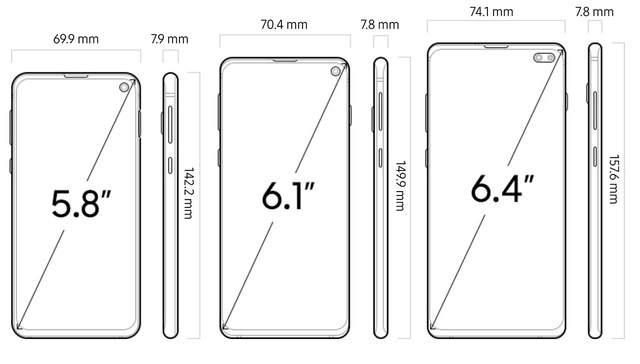
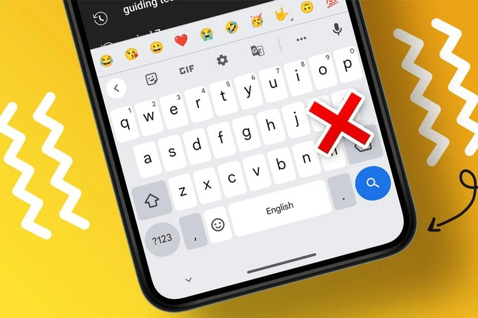
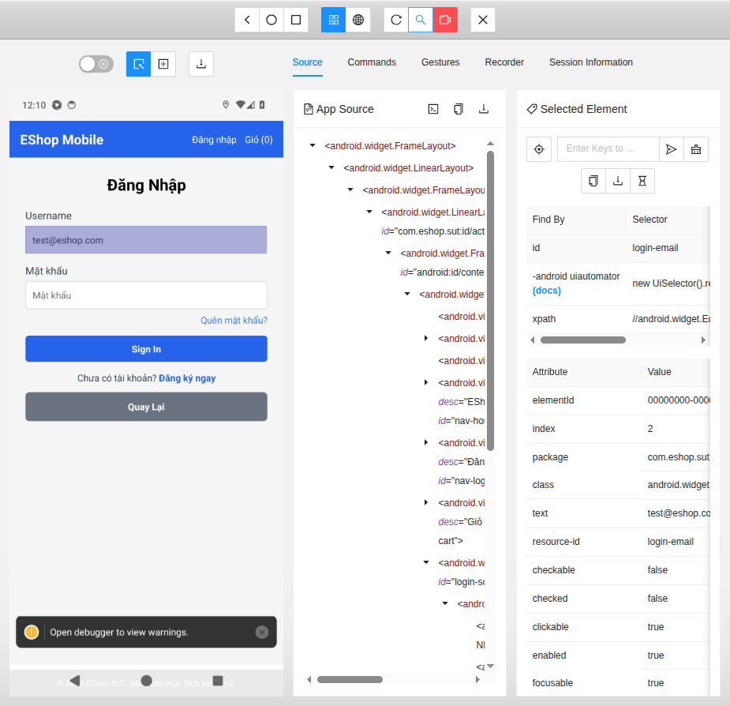
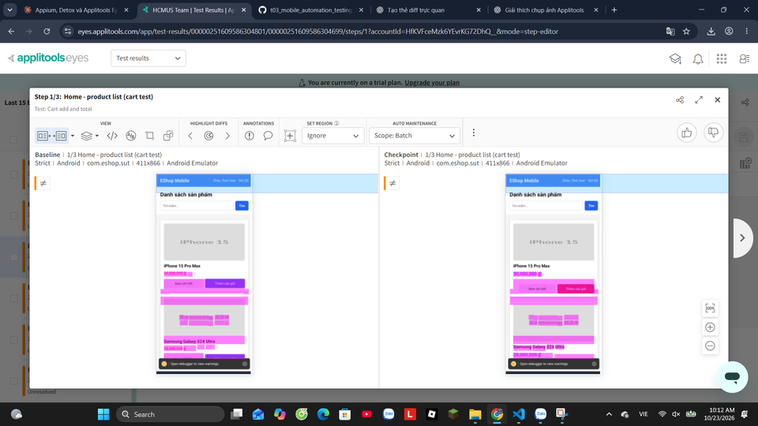

<!-- _class: title -->
<!-- _header: "" -->
<!-- _footer: "" -->
<div class="tl">
<div class="big">T03</div>
<div class="members"><b>Danh sách thành viên:</b>23120027 - Nguyễn Hải Đăng<br>23120031 - Nguyễn Phú Dinh<br>23120034 - Ứng Thị Thuỳ Dương</div>
<div class="foot">2026 AI-First · CS423/CSC15003</div>
</div>
<div class="tr">
<h1>Mobile Automation Testing với Appium 2 và Applitools Eyes</h1>
<div class="logos"></div>
<div class="band light">DEMO: Appium 2 + UiAutomator2 (truyền thống) · Applitools Eyes (AI visual)</div>
<div class="vlink">
Video demo: <a href="https://youtu.be/N3cN5d2LSG4">https://youtu.be/N3cN5d2LSG4</a><br>
<span class="small">Video theo phần (cài đặt · Record · Data-driven · Eyes): <code>Demo_Video_Links.md</code> · Hướng dẫn chạy lại: <code>User_Guide.md</code></span>
</div>
</div>

---

<!-- _footer: "2 · Đặc trưng kiểm thử mobile" -->
# Tại sao kiểm thử mobile khác web và app thường?

Cùng mục tiêu tìm lỗi trước người dùng, nhưng trên mobile **môi trường là một phần của bài test**.

| Đặc trưng | Mobile | Web / desktop thường |
|---|---|---|
| Phân mảnh máy + OS + DPI / OEM | Rất mạnh | Ít hơn (vài browser / vài OS) |
| Tương tác | Touch, swipe, long-press, bàn phím ảo che UI | Click, hover, bàn phím vật lý |
| Vòng đời app | Background, bị OS kill, xoay màn, mở lại giữa chừng | Tab / cửa sổ thường sống lâu |
| Gián đoạn | Gọi, noti, chuyển app — phải xét phục hồi | Hiếm là hạng mục riêng |
| Mạng | Wi‑Fi ↔ 4G, mất sóng, offline, sync lại | Thường giả định có mạng |
| Quyền, cảm biến, pin | Runtime permission, GPS/camera, pin | Hạn chế hơn (sandbox trình duyệt) |
| Phát hành | Store; máy giữ bản cũ lâu | Deploy server / installer |

- Cùng locator đúng vẫn có thể fail khi bàn phím che nút, cold start chưa lên foreground, hoặc baseline Eyes gắn nhầm AVD.
- Buổi demo đi sâu **chức năng** và **visual**; các hạng mục còn lại nằm ngoài phạm vi chạy thật.

 &nbsp;&nbsp; 

---

<!-- _footer: "3 · Các lớp kiểm thử" -->
# Kiểm thử mobile gồm những lớp nào?

<div class="two">
<div>
<div class="band">Phạm vi thường gặp</div>

| Khía cạnh | Câu hỏi ngắn |
|---|---|
| Chức năng | Luồng nghiệp vụ đúng chưa? |
| Giao diện / visual | Còn giống thiết kế không? |
| Tương thích | Máy / OS / độ phân giải? |
| Hiệu năng, pin, mạng | Chậm, tốn pin, mạng yếu? |
| Gián đoạn | Gọi, noti, chuyển nền? |
| Cài đặt / quyền | Cài mới, cập nhật, cấp quyền? |
| Usability / a11y, bảo mật | Dễ dùng? An toàn? |

</div>
<div>
<div class="band red">Hai lớp trong demo T03</div>

| | Functional | Visual |
|---|---|---|
| Hỏi | App **làm** đúng không? | App **trông** đúng không? |
| Chuẩn so | Giá trị kỳ vọng trong code | Ảnh baseline đã duyệt |
| Công cụ | Appium | Applitools Eyes |

- Functional pass chưa đủ để kết luận giao diện đúng
- Visual pass chưa đủ để kết luận dữ liệu đúng
- Hai lớp bổ sung nhau trên cùng luồng EShop

</div>
</div>

---

<!-- _footer: "4 · Khảo sát công cụ" -->
# Khảo sát công cụ — truyền thống và AI-augmented

<div class="two">
<div>
<div class="band">Truyền thống</div>

**Appium 2** — chuẩn WebDriver, đứng ngoài app, Android + iOS, không cần mã nguồn. ✅ **chọn làm lớp functional**

**Espresso** — chạy trong app, nhanh, chỉ Android, viết Kotlin. ✗

**Detox** — cho React Native, tự đồng bộ animation/network, cần build riêng. **Đã chạy thử cùng kịch bản: 3/3 lượt pass.** Hợp khi đội RN chỉ cần CI nhanh.

</div>
<div>
<div class="band red">AI-augmented</div>

**Applitools Eyes** — so ảnh với baseline bằng Visual AI, có ignore/layout region và dashboard duyệt. ✅ **chọn làm lớp visual**

**Maestro + AI assertion** — flow YAML, `assertWithAI` bằng LLM, không có baseline, không lịch sử duyệt. Dự phòng.

</div>
</div>

<div class="band green">Vì sao ghép Appium + Eyes</div>

Eyes gắn vào **cùng một session** Appium: assert chức năng và checkpoint visual chạy trên cùng luồng, cùng APK người dùng cài.

---

<!-- _footer: "5 · Ba khối nền tảng" -->
# Ba khối nền tảng trong demo Appium

<div class="three">
<div class="box"><b><span class="n">1</span> Record & Playback</b>Inspector khám phá UI và ghi thao tác. Code Recorder là bản nháp.</div>
<div class="box"><b><span class="n">2</span> Data-driven</b>Cùng một kịch bản, nhiều bộ dữ liệu.</div>
<div class="box"><b><span class="n">3</span> Checkpoints</b>Assert nghiệp vụ (Appium) và checkpoint giao diện (Eyes).</div>
</div>

---

<!-- _footer: "6 · Appium là gì" -->
# Appium là gì?

**Appium** là framework mã nguồn mở dùng để tự động hóa kiểm thử giao diện ứng dụng mobile thông qua các test script.

## Có thể làm gì?

- Tự động mở ứng dụng, nhập dữ liệu, nhấn nút.
- Tìm các thành phần giao diện và kiểm tra kết quả.
- Hỗ trợ Android và iOS thông qua các driver tương ứng.

## Hoạt động thế nào?

<div class="flow">
<div class="box"><b>Test Script (JavaScript)</b>Nhập "iPhone" → Nhấn Search → Kiểm tra kết quả</div>
<div class="arr">➜<small>Gửi lệnh WebDriver</small></div>
<div class="box"><b>Appium server</b>Nhận và chuyển lệnh cho driver</div>
<div class="arr">➜</div>
<div class="box"><b>Android Emulator</b>Thực hiện thao tác và trả kết quả</div>
</div>

---

<!-- _footer: "7 · Cấu trúc một file test" -->
# Một file test Appium thường gồm những phần nào?

Không phụ thuộc app cụ thể: hầu hết script WebdriverIO + Appium xếp theo cùng khung dưới đây. Có thể gom trong **một file** hoặc tách ra nhiều file — vẫn là các phần này.

<div class="flow">
<div class="box"><b>1 · Môi trường</b>host, port, capabilities</div>
<div class="arr">➜</div>
<div class="box"><b>2 · Locator</b>cách tìm phần tử</div>
<div class="arr">➜</div>
<div class="box"><b>3 · Thao tác màn hình</b>Page Object (tuỳ chọn)</div>
<div class="arr">➜</div>
<div class="box"><b>4 · Dữ liệu</b>bảng input / kỳ vọng</div>
<div class="arr">➜</div>
<div class="box"><b>5 · Chạy &amp; kiểm tra</b>action → wait → assert</div>
<div class="arr">➜</div>
<div class="box"><b>6 · Đóng phiên</b>teardown</div>
</div>

```js
// 1. Môi trường — nói Appium dùng máy nào, driver nào, app nào
const capabilities = { platformName: "Android", "appium:automationName": "UiAutomator2", /* app, … */ };
const driver = await remote({ hostname: "127.0.0.1", port: 4723, path: "/", capabilities });

// 2. Locator — định nghĩa cách tìm phần tử (ổn định hơn text hiển thị)
const byId = (id) => `android=new UiSelector().resourceId("${id}")`;

// 3–4. Thao tác + dữ liệu — có thể tách class Page Object và bảng cases
const cases = [{ keyword: "…", expected: 1 }, /* thêm dòng = thêm ca */];

// 5. Chạy test — lặp dữ liệu: thao tác → chờ điều kiện → assert
for (const row of cases) {
  await driver.$(byId("search-input")).setValue(row.keyword);
  await driver.waitUntil(/* kết quả đã hiện */);
  assert.equal(/* giá trị trên UI */, row.expected);   // checkpoint chức năng
}
// (tuỳ chọn) Eyes.check(...) — checkpoint giao diện, sau assert

// 6. Đóng phiên — luôn gọi, kể cả khi fail
await driver.deleteSession();
```

<span class="small">Các slide sau đi lần lượt từng phần trong khung này.</span>

---

<!-- _footer: "8 · Appium Inspector — Record" -->
# Appium Inspector — Khám phá giao diện và tìm Locator

<div class="two w60">
<div>



</div>
<div>

## Appium Inspector là gì?

Công cụ hỗ trợ quan sát cấu trúc giao diện, xem thuộc tính phần tử và thử các thao tác trên ứng dụng.

## Ba tính năng chính

- **Inspect UI Elements:** xem cây giao diện và thuộc tính phần tử.
- **Find & Test Locators:** tìm phần tử bằng locator và thử Tap, Send Keys.
- **Record Actions:** ghi thao tác và sinh code mẫu WebdriverIO.

`testID` trên React Native xuất hiện thành `resource-id` (ví dụ `login-email`).

=> Inspector giúp **tìm locator trước khi viết test**. Code Recorder là bản nháp; test nộp giữ Page Object kèm wait và assertion.

<div class="band red" style="margin-top:10px">Quit Session trước khi chạy test tự động</div>

</div>
</div>

---

<!-- _footer: "9 · Session & Capabilities" -->
# Bắt đầu một Appium Test — Session & Capabilities

```js
const driver = await remote({
  hostname: "127.0.0.1", port: 4723, path: "/",        // Appium 2: "/"; Appium 1: "/wd/hub"
  capabilities: {
    platformName: "Android",
    "appium:automationName": "UiAutomator2",           // chọn driver
    "appium:app": ".../app-debug.apk",                  // APK cần cài khi tạo session
    "appium:appPackage": "com.example.app",
    "appium:noReset": false,                            // mỗi lần chạy bắt đầu sạch
  },
});
```

- **Session:** Phiên làm việc giữa test script và Appium Server để điều khiển ứng dụng trên thiết bị.
- **Capabilities:** Các thông tin cấu hình cho Appium biết cần sử dụng nền tảng, driver và ứng dụng nào.

<div class="flow">
<div class="box"><b>Create Session</b>Kết nối và chuẩn bị ứng dụng</div>
<div class="arr">➜</div>
<div class="box"><b>Execute Test</b>Tìm phần tử, thao tác, kiểm tra kết quả</div>
<div class="arr">➜</div>
<div class="box"><b>End Session</b>Giải phóng tài nguyên</div>
</div>

---

<!-- _footer: "10 · Locator" -->
# Locator — Appium tìm phần tử giao diện như thế nào?

**Locator:** là cách xác định một phần tử trên giao diện ứng dụng để Appium có thể tương tác với nó.
Ví dụ: Để Appium nhập email, trước tiên phải tìm đúng ô nhập email.

```xml
<android.widget.EditText resource-id="login-email" ... />
```

| Ưu tiên | Chiến lược | Cú pháp WebdriverIO | Ghi chú |
|---|---|---|---|
| 1 | `resource-id` | `android=new UiSelector().resourceId("login-email")` | Ổn định, do dev đặt (`testID`) |
| 2 | accessibility id | `~Đăng nhập` | Từ `accessibilityLabel` |
| 3 | text | `android=new UiSelector().text("Tìm")` | Gãy khi đổi chữ / ngôn ngữ |
| 4 | XPath | `//android.widget.EditText[@resource-id="login-email"]` | Chậm, gãy khi đổi bố cục |

**Best practice:** Ưu tiên Locator ổn định, ít phụ thuộc vào vị trí và cấu trúc giao diện để giảm chi phí bảo trì test.

---

<!-- _footer: "11 · Nhiều bộ dữ liệu" -->
# Thao tác với nhiều bộ dữ liệu

Cùng **một** chuỗi thao tác (tìm kiếm, đăng nhập, …), đổi **nhiều** bộ đầu vào. Dữ liệu để ở bảng; test chỉ việc lặp từng dòng.

| Bước | Việc làm |
|---|---|
| 1 | Khai báo bảng: mỗi dòng = *(đầu vào → kỳ vọng)* |
| 2 | `for` từng dòng → chạy lại cùng thao tác |
| 3 | `assert` so UI với kỳ vọng của dòng đó |

<div class="two">
<div>
<div class="band">Ví dụ bảng</div>

| Đầu vào | Kỳ vọng |
|---|---|
| từ khóa A | 1 kết quả |
| từ khóa B | 2 kết quả |
| không có trong catalogue | 0 kết quả |

</div>
<div>
<div class="band red">Gắn vào script</div>

```js
for (const row of cases) {
  await search(row.keyword);             // cùng thao tác
  assert.equal(count(), row.expected); // kỳ vọng theo dòng
}
```

Thêm ca mới = thêm một dòng vào bảng — không copy-paste cả test.

</div>
</div>

---
<!-- _footer: "12 · Đọc kết quả Pass / Fail" -->
# Sau khi chạy Appium — làm sao biết Pass / Fail?

Appium **không** tự hiện “đúng/sai” trên emulator. Kết quả do **assertion trong script** quyết định; test runner in ra terminal.

<div class="two">
<div>
<div class="band">Trong code</div>

```js
assert.equal(actual, expected);
// khớp  → test / subtest Pass
// lệch  → ném lỗi → Fail
```

| | Ý nghĩa |
|---|---|
| **Pass** | Mọi assert của ca đó đều khớp |
| **Fail** | Có assert lệch (hoặc timeout / không thấy phần tử) |

Với nhiều bộ dữ liệu: mỗi dòng bảng là một subtest — fail một dòng **không** dừng các dòng còn lại.

</div>
<div>
<div class="band red">Trên terminal (sau khi chạy xong)</div>

```text
# Subtest … tìm "A"
ok 1 - tìm "A"
# Subtest … tìm "B"
not ok 2 - tìm "B"
  AssertionError: …

# tests 2
# pass 1
# fail 1
```

- Nhìn dòng `ok` / `not ok` từng ca  
- Cuối file: tổng `# pass` / `# fail`  
- Exit code ≠ 0 nếu còn fail  

<span class="small">Ví dụ demo: cả bộ xanh → <code># pass 8</code> <code># fail 0</code>.</span>

</div>
</div>


---

<!-- _class: test -->
<!-- _footer: "13 · Viết một Appium Test" -->
# Viết một Appium Test — Locator, Action & Assertion

**Kịch bản — Verify Cart Total:** thêm *iPhone 15 Pro Max* (30 000 000 ₫) vào giỏ 2 lần → tổng tạm tính phải là **60 000 000 ₫**.

<div class="flow">
<div class="box"><b>1 · Locator</b><span>Tìm nút “Thêm vào giỏ” (<code>product-add-1</code>)</span></div>
<div class="arr">➜</div>
<div class="box"><b>2 · Action</b><span>Bấm 2 lần, mở giỏ hàng</span></div>
<div class="arr">➜</div>
<div class="box"><b>3 · Wait</b><span>Chờ dòng tổng tiền hiện ra</span></div>
<div class="arr">➜</div>
<div class="box"><b>4 · Assertion</b><span>Tổng = 60 000 000 ₫?</span></div>
<div class="arr">➜</div>
<div class="box"><b>Test Result</b><span>PASS / FAIL dựa trên Assertion</span></div>
</div>

<div class="codeshot">
<div>
<pre><code>const byId = (id) =&gt; driver.$(`android=new UiSelector().resourceId("${id}")`);
const addBtn = await byId("product-add-1");          <span class="c-step">// 1 Locator</span>
for (let i = 0; i &lt; 2; i++) {                        <span class="c-step">// 2 Action: thêm 2 lần</span>
  await addBtn.click();
  await (await byId("android:id/button1")).click();  <span class="c-sub">// đóng hộp thoại "Thành công"</span>
}
await (await byId("nav-cart")).click();
const total = await byId("cart-total");
await total.waitForDisplayed({ timeout: 10_000 });   <span class="c-step">// 3 Wait: chờ điều kiện</span>
assert.equal((await total.getText()).replace(/\D/g, ""), "60000000");  <span class="c-step">// 4 Assertion</span></code></pre>

<div class="bp"><b>Best practice:</b> Explicit Wait — chờ điều kiện cụ thể thay vì thời gian cố định. Bộ test thật gom các bước vào Page Object (<code>home.addToCart(1, 2)</code>).</div>
</div>
<div class="shot">


<span class="small">Màn giỏ hàng EShop lúc test chạy trên emulator (23/10/2026).</span>

</div>
</div>

<div class="test-takeaway">Test này pass vì tổng tiền đúng. Nhưng nếu dòng tổng lệch sang trái và nút thanh toán đổi màu, Appium có phát hiện được không? → Applitools Eyes</div>

---

<!-- _footer: "14 · Eyes — Checkpoint và Baseline" -->
# Applitools Eyes — Checkpoint và Baseline

Eyes gắn cùng session Appium: sau khi assert chức năng xong, Eyes sẽ chụp màn hình và so với ảnh chuẩn đã duyệt.

<div class="two">
<div>

| | |
|---|---|
| **Checkpoint** | Ảnh chụp lần chạy hiện tại, tại một bước đã ổn định (sau assert) |
| **Baseline** | Ảnh đã Accept — chuẩn để so lần sau |
| **Visual diff** | Vùng Eyes tô khi checkpoint lệch baseline |
| **Match level** | Strict, Layout…; có thể gắn ignore / layout region |

<div class="band light">Từ chụp đến duyệt</div>

1. Đưa app tới trạng thái đã biết  
2. `eyes.check(...)` tạo checkpoint  
3. So với baseline cùng tên bước và cùng cấu hình máy  
4. Khớp → Passed; lệch → Unresolved  
5. Accept → thành baseline mới; Reject → ghi nhận lỗi  

<span class="small">Lần đầu chưa có chuẩn: trạng thái New; Accept lần đầu tạo baseline.</span>

</div>
<div>
<div class="band red">Cùng session Appium</div>

```js
await openEyes(eyes, driver, "Cart add and total");
await checkpointAs(eyes, "cartFilled",
  "Cart - 1 item with total");
await closeEyes(eyes);
// Eyes: Passed | … | link dashboard
```

- Eyes so ảnh, không đọc giá trị tiền như assertion.  
- Baseline gắn một AVD; đổi máy thường cần baseline mới.


<span class="small">Trái: baseline · Phải: checkpoint · vùng tô: diff</span>

</div>
</div>

---

<!-- _footer: "15 · Eyes — Dashboard và kết quả" -->
# Xem kết quả Eyes trên dashboard

Sau khi chạy, terminal in trạng thái và link batch. Chi tiết so ảnh nằm trên **Eyes Cloud**.

<div class="two">
<div>
<div class="band">Từ terminal tới dashboard</div>

1. Chạy test với `APPLITOOLS_API_KEY`  
2. Terminal: `Eyes: Passed | Unresolved | …` + URL  
3. Mở Applitools Dashboard  
4. Chọn test → từng step là một checkpoint  
5. Xem baseline / checkpoint / diff  
6. Accept hoặc Reject từng bước  

<div class="band green" style="margin-top:10px">Khi demo / CI</div>

- `eyes.close(false)`: TAP chức năng vẫn có thể `# fail 0` khi có diff visual  
- Cần mở dashboard để triage  
- Ảnh lưu sẵn: `docs/evidence/B1_B2_applitools-dashboard/`

</div>
<div>
<div class="band red">Ba bản giao diện</div>

| Bản | Appium | Eyes |
|---|---|---|
| **base** | 8/8 pass | Passed |
| **V1** đổi ảnh SP | 8/8 pass | Unresolved 5/10 |
| **V2** đổi màu + lệch layout | 8/8 pass | Unresolved 6/10 |

- V1: đổi chủ đích → thường Accept hoặc Layout region  
- V2: regression giao diện mà functional không thấy → Reject  
- Clip: <a href="https://youtu.be/N3cN5d2LSG4?t=246">youtu.be/… (4:06)</a>

</div>
</div>

---

<!-- _footer: "16 · Tính năng hai công cụ" -->
# Tính năng của hai công cụ

<div class="two">
<div>
<div class="band">Appium</div>

- Điều khiển APK qua WebDriver: mở app, nhập liệu, nhấn nút.
- Record (Inspector), data-driven và assertion chức năng.
- Đọc text / trạng thái để xác minh nghiệp vụ (đăng nhập, tìm kiếm, tổng giỏ).
- Chạy trên emulator, thiết bị thật hoặc device farm.

</div>
<div>
<div class="band red">Applitools Eyes</div>

- So màn hình hiện tại với baseline bằng Visual AI.
- Hỗ trợ match level và ignore / layout region.
- Dashboard để Accept hoặc Reject từng checkpoint.
- Gắn cùng session Appium sau bước assert chức năng.

</div>
</div>

<div class="band green">Hai lớp bổ sung nhau — Appium không thay Eyes; Eyes không thay assert giá hay quyền</div>

<span class="small">Lưu ý khi dùng: Appium cần wait và locator ổn định; Eyes cần người duyệt baseline và không bắt lỗi không hiện trên ảnh.</span>

---

<!-- _class: divider -->
<!-- _footer: "17 · Hoạt động lớp" -->
# Visual Diff Triage Workshop

---

<!-- _class: qa -->
<!-- _footer: "18 · Q&A" -->
# Q&A

<div class="vlink">
Video demo: <a href="https://youtu.be/N3cN5d2LSG4">https://youtu.be/N3cN5d2LSG4</a><br>
<span class="small"><code>Demo_Video_Links.md</code> · <code>User_Guide.md</code></span>
</div>
